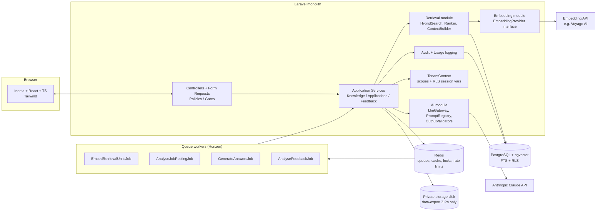
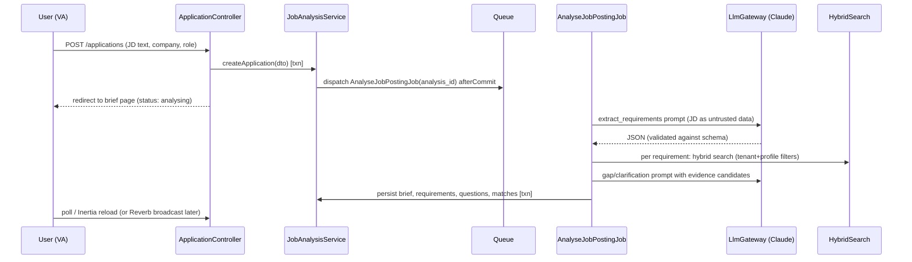
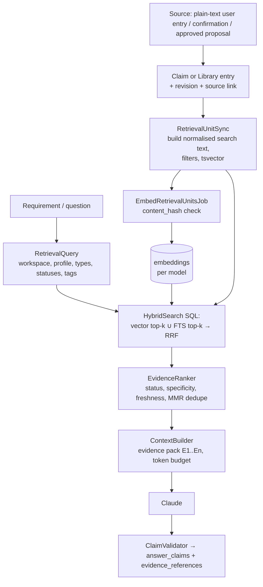

# Deliverable 2 — Architecture

## 2.1 System diagram



Single deployable Laravel app; web and worker processes from the same codebase. All input arrives as plain text from UI forms (D8) — there is no file-upload or document-ingestion path. No separate retrieval service, Python backend, vector DB, or agent framework in MVP.

## 2.2 Component responsibilities (module layout)

Use domain folders under `app/` (no package/modules framework needed):

```
app/
  Http/Controllers/…            thin: authorise, validate, call service, return Inertia
  Http/Requests/…               validation
  Policies/…                    per-model authorisation
  Domain/
    Tenancy/                    Workspace, Membership, TenantContext, BelongsToWorkspace trait, RLS middleware
    Knowledge/                  CandidateProfile, Employment, Project, Claim, ClaimRevision, Source,
                                AnswerLibraryEntry, WritingPreference; KnowledgeService, DuplicateDetector
    Retrieval/                  RetrievalUnit, Embedding, EmbeddingModel; RetrievalUnitSync,
                                HybridSearch, EvidenceRanker, ContextBuilder, RetrievalQuery DTO
    Ai/                         LlmClient (interface), AnthropicLlmClient, PromptRegistry, PromptTemplate,
                                GenerationRun, StructuredOutput validators, CostCalculator
    Embeddings/                 EmbeddingProvider (interface), VoyageEmbeddingProvider, FakeEmbeddingProvider
    Applications/               JobApplication, JobPosting, JobAnalysis, Requirement, ApplicationQuestion,
                                AnswerDraft, AnswerVersion, AnswerClaim, EvidenceReference;
                                JobAnalysisService, AnswerGenerationService, ClaimValidator, ExportService
    Feedback/                   FeedbackEvent, KnowledgeProposal; FeedbackAnalysisService, ProposalApplier
    Audit/                      AuditEvent, AuditLogger
  Jobs/                         queue jobs (thin; call services)
  Data/                         DTOs (spatie/laravel-data or plain readonly classes — decide in M1)
resources/js/
  Pages/…  Components/…  types/ (generated from DTOs)
prompts/                        versioned prompt templates (files in git) + JSON schemas
```

Rules: controllers never call the LLM directly; services own transactions; jobs are idempotent wrappers around services; only `Retrieval` builds vector/FTS SQL; only `Ai` talks to Anthropic.

## 2.3 Request and job flows

**JD analysis (async with progress):**


**Generation:** `POST /applications/{id}/generate` → `GenerateAnswersJob(application_id, question_ids, idempotency_key)` → for each question: RetrievalQuery → ContextBuilder (evidence pack with stable IDs `E1..En`) → Claude structured output → ClaimValidator → persist `answer_versions` + `answer_claims` + `evidence_references` in one transaction.

**Feedback:** saving a human edit creates a new `answer_version` (author=user). On "Approve" or explicit "Learn from my edits", dispatch `AnalyseFeedbackJob(feedback_event_id)` → Claude classifies diff → `knowledge_proposals` (status `pending`) → approval queue → `ProposalApplier` writes new revisions in a transaction.

## 2.4 RAG data flow



## 2.5 Key design decisions (summary; full ADRs in Deliverable 6)
- **Monolith** over services: one developer, low volume; module boundaries in code suffice.
- **Hybrid retrieval inside PostgreSQL** (one SQL query, reciprocal rank fusion) — no separate search service until measured need (see ADR-4 triggers).
- **Derived `retrieval_units` table** decouples canonical knowledge (claims, library answers, employment/project summaries) from search representation; can be rebuilt any time.
- **Claims as atomic facts** with append-only revisions — the unit of verification and citation.
- **Human-in-the-loop for every canonical write** originating from AI.
- **Async jobs for every LLM call** (no LLM calls in the web request path), so timeouts/retries are controlled.
