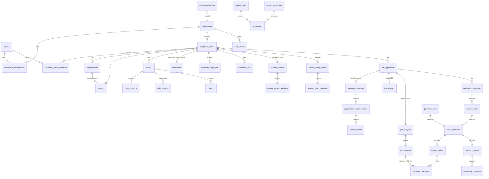

# Deliverable 3 — Database design

## 3.1 Conventions
- PKs: `bigint` identity internally + `ulid` public id column for URLs (avoids enumeration). **Every tenant table has `workspace_id NOT NULL`** (denormalised on purpose for RLS, indexes and cheap filtering).
- Composite FKs `(workspace_id, x_id)` → `(workspace_id, id)` on key relationships so a row can never reference another workspace's row (requires `UNIQUE (workspace_id, id)` on parents). This is the cheapest strong isolation guarantee Postgres offers.
- Timestamps `timestamptz`. Soft deletes only where restore is a product feature (applications); knowledge uses `status = archived` + revisions instead.
- Optimistic locking: `lock_version int` on mutable heads (claims, answer_drafts, applications, proposals).
- Enums as `text` + `CHECK` constraints (easier migrations than PG enums).

## 3.2 ER diagram (core)

## 3.3 Table definitions (important columns)

### Identity & tenancy
- **users**: id, ulid, name, email (unique, citext), password, two_factor_*, is_active, last_login_at.
- **workspaces**: id, ulid, name, settings jsonb (default models), monthly_ai_budget_micros bigint (default 30_000_000 = US$30), budget_warn_pct smallint (default 80), created_by. MVP: exactly one row, created by a seeder/install command.
- **workspace_memberships**: id, workspace_id, user_id, role (`candidate|va`), created_by. `UNIQUE(workspace_id, user_id)`; partial unique `UNIQUE(workspace_id) WHERE role='candidate'` (exactly one candidate); VA seat limit (≤ 3 active) enforced in `MembershipService` inside a transaction with `FOR UPDATE` on the workspace row.
- **candidate_profiles**: id, ulid, workspace_id, user_id (the candidate's account), display_name, contact info shared by every resume variant (email citext, phone, location). The former `headline` was copied into a default resume's title and dropped (M3 slice 4). `UNIQUE(workspace_id, id)`. MVP: one row — the *person*; resume variants are separate rows (see "Resumes").
- (Dropped for MVP: invitations table — candidate creates VA accounts directly and shares a password-reset link; candidate_profile_members; extra roles.)

### Career knowledge (canonical)
- **employments**: id, workspace_id, candidate_profile_id, employer_name, employer_normalized, title, employment_type, location, start_date, end_date (null=current), date_precision (`day|month|year`), summary, status (`verified|proposed|archived`), lock_version.
- **projects**: id, workspace_id, candidate_profile_id, employment_id (nullable), name, client_name (nullable — careful: confidential), role, start/end, summary, url, status, lock_version.
- **claims** — the atomic, citable unit:
  - id, ulid, workspace_id, candidate_profile_id
  - subject_type (`employment|project|credential|general`), subject_id (nullable)
  - kind (`achievement|responsibility|skill|qualification|other`) — kept short on purpose: a metric is an achievement with a number, a technology is a skill
  - current_revision_id (FK claim_revisions)
  - status (`verified|proposed|rejected|archived`) — **only verified claims can back a `verified` label**; `rejected` = a proposed claim the candidate turned down (restorable)
  - origin (`user_entered|ai_suggested|feedback_derived|imported`)
  - normalized_hash (sha256 of normalised statement — exact-dup guard)
  - verified_by, verified_at, lock_version
  - Constraints: `CHECK (status <> 'verified' OR verified_by IS NOT NULL)`; partial unique `UNIQUE(candidate_profile_id, normalized_hash) WHERE status IN ('verified','proposed')`.
- **claim_revisions** (append-only): id, workspace_id, claim_id, revision_no, statement text, structured jsonb (e.g. `{metric: {value, unit, period}, technologies: []}`), date_from/date_to, change_reason, created_by, created_via (`manual|proposal:{id}|import`), created_at. `UNIQUE(claim_id, revision_no)`.
- **claim_sources** (provenance, many per claim): id, workspace_id, claim_id, claim_revision_id, source_type (`user_confirmation|project|employment|external_url|answer_version`), source_id, quote/excerpt (short span), confirmed_by, created_at. Note: `answer_version` source is allowed only to record *where it was first suggested*; it never satisfies verification on its own (enforced in `KnowledgeService::verify`, which requires a `user_confirmation` source).
- **tags**: id, workspace_id, kind (`skill|technology|domain|industry`), name, normalized_name. `UNIQUE(workspace_id, kind, normalized_name)`.
- **taggables**: tag_id, taggable_type, taggable_id, workspace_id.
- **credentials** (education and certifications): id, ulid, workspace_id, candidate_profile_id, type (`education|certification`), institution (school / issuer), name (degree / certificate), field_of_study, start_date, end_date (awarded), expires_on, credential_url, summary, status (`verified|proposed|archived`), verified_by/at, created_by, lock_version. Same lifecycle as employments/projects; claims can have `subject_type = credential`.
- **candidate_languages**: id, workspace_id, candidate_profile_id, language, proficiency (`native|fluent|professional|conversational|basic`), position.
- **candidate_links**: id, workspace_id, candidate_profile_id, kind (`portfolio|github|linkedin|website|other`), label, url (http/https only), position.
- **Skills**: `tags` (kind `skill|technology|domain`) attached to the candidate profile via `taggables`; claims are tagged the same way.

### No documents tables (D8)
There are no `documents` / `document_chunks` tables: nothing is uploaded or extracted. All knowledge is plain text stored directly on the canonical rows (`claim_revisions.statement`, `employments.summary`, `projects.summary`, library answer bodies). Longer context, such as a case study, goes into a project's `summary` as plain text.

### Reusable content
- **answer_library_entries**: id, workspace_id, candidate_profile_id, question (plain text, trigram-indexed), category (`motivation|strengths|weaknesses|behavioural|technical|salary|availability|other`), current_revision_id, status (`approved|draft|archived`), approved_by/at, lock_version. Merges the prompt's `question_templates` and `approved_answers`. Entries are profile-owned in the MVP; workspace-shared templates are deferred.
- **answer_library_revisions**: answer_library_entry_id, revision_no, body (trigram-indexed), claim_ulids jsonb (claims the answer relies on; validated as live claims of the workspace on save), change_reason, created_by, created_via (`manual|proposal:{id}`). Append-only (DB trigger).
- **writing_preferences**: id, workspace_id, scope (`user|profile|workspace`), user_id / candidate_profile_id (per scope), rule text (e.g. "British spelling", "No 'passionate'"), kind (`tone|banned_phrase|format|spelling|structure`), status, examples jsonb, created_via. CHECK that exactly the right owner column is set for the scope.

### Retrieval (derived, rebuildable)
- **retrieval_units**: id, workspace_id, candidate_profile_id (nullable for workspace-shared), visibility, unit_type (`claim|library_answer|project_summary|employment_summary`), source_type, source_id, source_revision_id, status (copied from source: `verified|proposed|approved`), search_text, tsv `tsvector GENERATED ALWAYS AS (to_tsvector('english', search_text)) STORED`, tag_ids int[], employer_normalized, date_to, specificity_score real, content_hash, is_active bool, updated_at. `UNIQUE(source_type, source_id)`.
- **embedding_models**: id, provider, model, dimensions, distance (`cosine`), input_type_doc, input_type_query, is_active_for_write, is_active_for_read, created_at.
- **embeddings**: id, workspace_id, retrieval_unit_id, embedding_model_id, content_hash, embedding `halfvec` (no fixed dimension at column level; `ALTER COLUMN embedding SET STORAGE PLAIN` so values stay inline instead of TOASTed — S3), created_at. `UNIQUE(retrieval_unit_id, embedding_model_id)`.

### Applications
- **jd_collections**: id, workspace_id, name, description, use_for_eval bool, created_by. `UNIQUE(workspace_id, name)`.
- **jd_collection_items**: jd_collection_id, job_application_id, added_by, added_at. PK(collection, application). Many-to-many so one JD can sit in several groups.
- **job_applications**: id, ulid, workspace_id, candidate_profile_id, company_name, role_title, source_url, location, employment_type, salary_text, stage (`saved|preparing|applied|interviewing|offer|rejected|withdrawn`, the job-search pipeline), review_status (`not_started|in_progress|in_review|changes_requested|approved`, the VA preparation workflow; D10), analysis_status (M7: `none|analysing|ready|failed`), owner_user_id, assigned_user_id, deadline_on (date), submitted_at, notes, lock_version, deleted_at.
- **job_postings**: id, workspace_id, job_application_id (unique), raw_text (verbatim, immutable), raw_sha256, captured_at, captured_by.
- **job_analyses**: id, workspace_id, job_application_id, generation_run_id, prompt_version, brief jsonb (validated: summary, employer language, seniority, must-haves, nice-to-haves, red flags, injection_warnings), status, created_at. Multiple per application (re-analysis); `job_applications.current_analysis_id`.
- **requirements**: id, workspace_id, job_analysis_id, kind (`must|preferred|responsibility|employer_value`), text, importance smallint, verbatim_quote.
- **application_questions**: id, workspace_id, job_application_id, origin (`extracted|manual|cover_letter`), prompt_text, word_limit, char_limit, position, status.
- **clarification_requests**: id, workspace_id, job_application_id, question_text, reason, related_requirement_id, answer_text, answered_by, converted_claim_id (if the answer became a proposed claim).

### Resumes (D9, ADR-9)
Facts live once in the master record; resume variants and tailored resumes only **choose, order and word** them.
- **resume_variants** (M3): id, ulid, workspace_id, candidate_profile_id, name (internal, e.g. "Laravel backend"), is_default (partial unique per profile `WHERE is_default`), status (`active|archived`), current_revision_id, lock_version.
- **resume_variant_revisions** (append-only, M3): id, workspace_id, resume_variant_id, revision_no, document jsonb, created_by, created_via (`manual|duplicated:{id}|from_application:{id}|proposal:{id}`), created_at. `UNIQUE(resume_variant_id, revision_no)`.
- **application_resumes** (M7): id, ulid, workspace_id, job_application_id (unique), based_on_variant_id, based_on_revision_id, current_version_id, approved_version_id, status (`draft|in_review|approved`), lock_version.
- **application_resume_versions** (append-only, M7): id, workspace_id, application_resume_id, version_no, document jsonb, facts_snapshot jsonb (employer/title/dates/degree as they were when the version was made, so a submitted resume can be reproduced), author_type (`user|ai`), author_user_id, generation_run_id, parent_version_id, created_at. An approved version is frozen; if the master record changes later, the UI shows "facts changed since this version".
- **resume_claims** (M8): same shape as `answer_claims` (classification, validation flags, resolution), plus `path` into the document (e.g. `experience.0.bullets.2`).

**Resume document** (`schema_version: 1`, validated by `ResumeDocumentValidator` on every save; one format for variants and tailored versions; slice 5 adds `skills`, `education`, `certifications`, `languages`, `links` keys):
`{schema_version, title, summary, experience: [{employment: ulid, display_title, description, bullets: [{claim: ulid, text}], projects: [{project: ulid, description, bullets: [...]}]}], projects: [{project: ulid, description, bullets: [...]}], skills: [{label, items: [skill ulid]}], education: [{credential: ulid}], certifications: [{credential: ulid}], languages: [language ulid], links: [link ulid]}` (sections missing from older revisions read as empty lists)
- Facts (employer, official job title, dates, institution) and contact details are **not** in the document: they are read from the master record by ULID, so they cannot be changed per variant or per job.
- `display_title` (optional): how this resume shows the job title; the official title stays on the employment (and in `facts_snapshot` for tailored versions). Candidate-only; the AI may reuse existing display titles but never invent one.
- Every bullet is backed by a claim: `{claim, text}` where `text = null` uses the claim's current wording and a non-null `text` is a rewording for this resume only.
- On save: every ULID exists in this workspace and is not archived; each job appears once; projects under a job belong to that job, top-level projects are standalone; each bullet's claim is a live claim about that job/project; plain-text normalisation and length limits apply.
- Trade-off (ADR-9): refs inside JSON have no foreign key. An archived or removed item shows as "Removed from your record" in the editor.
- Variants and tailored versions are **never embedded or retrieved as evidence**.

### Answers, versions, claims, evidence
- **answer_drafts**: id, workspace_id, application_question_id, current_version_id, approved_version_id, status (`generating|draft|in_review|approved`), lock_version.
- **answer_versions** (append-only): id, workspace_id, answer_draft_id, version_no, body text, author_type (`ai|user`), author_user_id, generation_run_id, parent_version_id, created_at. `UNIQUE(answer_draft_id, version_no)`.
- **answer_claims**: id, workspace_id, answer_version_id, span_start, span_end, text, classification (`verified|inferred|proposed|hypothetical`), model_classification (what the LLM said, for eval), validation_flags text[] (e.g. `downgraded_no_verified_evidence`, `metric_without_source`), resolution (`open|accepted|removed|converted_to_proposal`), resolved_by.
- **evidence_references**: id, workspace_id, referrer_type (`answer_claim|resume_claim|requirement`), referrer_id, retrieval_unit_id, source_type, source_id, source_revision_id (pin the exact revision cited), relevance_score, rank.

### Feedback & proposals
- **feedback_events**: id, workspace_id, answer_draft_id, from_version_id, to_version_id, user_id, diff jsonb (computed server-side), analysis jsonb (Claude output), generation_run_id, status (`pending_analysis|analysed|failed`).
- **knowledge_proposals**: id, ulid, workspace_id, candidate_profile_id, origin (`feedback|achievement_suggestion|clarification|manual`), origin_id, proposal_type (built in M3 slices 6–7: `revise_claim|revise_record|revise_library_answer`; later: `create_claim|archive_claim|create_library_answer|create_writing_preference|one_off_no_action`), target_type (`claim|employment|project|credential|answer_library_entry`), target_id, base_version (claim: current revision id; other records: lock_version — for conflict detection), payload jsonb (the new values, as validated by the item's form request), rationale, status (`pending|approved|rejected|superseded|conflict`), proposed_by_user_id / proposed_by_run_id, decided_by, decided_at, decision_note, lock_version.
  - Partial unique: `UNIQUE(target_type, target_id, proposal_type) WHERE status='pending'` for revise types — prevents conflicting concurrent pending edits; new ones mark older as `superseded`.

### Operations
- **generation_runs**: id, ulid, workspace_id, purpose (`jd_analysis|answer_generation|feedback_analysis|achievement_suggestion|grounding_check`), prompt_key, prompt_version, model, request_hash, idempotency_key (unique), input_tokens, output_tokens, cache_read_tokens, cache_write_tokens, cost_micros, latency_ms, status (`queued|running|succeeded|failed|invalid_output`), error_code, attempt, created_by. Store prompt/response bodies **only** in an encrypted, TTL'd `generation_payloads` table (debug, default 14-day retention) — not in logs.
- **audit_events**: id, workspace_id, actor_user_id, actor_type (`user|system|job`), action (`claim.verified`, `proposal.approved`, `data_export.downloaded`, `member.role_changed`, …), subject_type, subject_id, metadata jsonb (no content bodies), ip_hash, created_at. Append-only (revoke UPDATE/DELETE from app role). Doubles as activity history.

## 3.4 How the schema supports the requirements
- **Provenance**: `claim_sources` (+ pinned `claim_revision_id`), `evidence_references.source_revision_id`, `knowledge_proposals.origin`.
- **Verification status**: `claims.status` + `verified_by/at` CHECK; `answer_claims.classification` + validator flags.
- **Versioning**: append-only `*_revisions`/`answer_versions`; heads carry `current_revision_id` + `lock_version`.
- **Private vs shared**: `candidate_profile_id` (private to profile) vs `NULL` + `visibility='workspace'` (shared templates); `writing_preferences.scope` for user-level.
- **Embedding model/dimension changes**: `embedding_models` + per-model rows in `embeddings`; untyped `halfvec` column with per-model partial expression HNSW indexes when needed (`(embedding::halfvec(1024))` with `WHERE embedding_model_id = N`; the same pattern on `vector` was verified to work in S3; HNSW dimension limit for `halfvec` is 4,000 **[VERIFY]** against the pgvector README before adding the index).
- **Efficient hybrid retrieval**: one table (`retrieval_units`) with GIN on `tsv`, btree on `(workspace_id, candidate_profile_id, unit_type, status)`, GIN on `tag_ids`, HNSW per model on `embeddings`.
- **Concurrent edit/approval**: `lock_version` checks (409 on mismatch with merge UI), `SELECT … FOR UPDATE` on proposal + target in `ProposalApplier`, base-revision conflict detection.
- **Tenant isolation**: `workspace_id` everywhere, global scope, policies; RLS later (3.6).

## 3.5 Indexes & pgvector strategy
- `retrieval_units`: `GIN(tsv)`; `BTREE(workspace_id, candidate_profile_id, is_active, unit_type, status)`; `GIN(tag_ids)`.
- `embeddings`: `BTREE(workspace_id, embedding_model_id)` from the start. HNSW `((embedding::halfvec(D)) halfvec_cosine_ops) WHERE embedding_model_id = N` per active model **only once needed** (see below).
- **Measured in S3 (`docs/spikes/S3.md`)**: exact scan within the tenant/profile filter takes ≤ 15 ms for ~7k matching rows with `halfvec`, so the **MVP ships without a vector index**. Add HNSW when a profile exceeds ~10k active units or retrieval p95 > 150 ms. Once an HNSW index exists, HybridSearch must run `SET LOCAL hnsw.iterative_scan = relaxed_order` in its transaction: without it, filtered HNSW silently returns too few rows (14 of 40 in S3), and with it recall is ~0.96.
- Other: `job_applications(workspace_id, status, deadline_at)`, `(workspace_id, assigned_user_id, status)`; `knowledge_proposals(workspace_id, status, created_at)`; `audit_events(workspace_id, created_at desc)`; `claims(candidate_profile_id, status, kind)`; trigram index on `claims` statement (via `claim_revisions`) for near-duplicate detection (`pg_trgm`).

## 3.6 Access control & tenant isolation (MVP: simple, future-proof)
With one workspace and one candidate, the real MVP boundary is **role** (candidate vs VA) and **authentication** (nobody else sees anything). Plan:
1. **Laravel authorisation** (MVP, primary): policies + gates for every action (`verify-claim`, `approve-proposal`, `manage-vas`, `manage-budget` → candidate only). All routes behind `auth` + 2FA for the candidate.
2. **Tenant scoping kept in code from day one, cheaply**: every tenant table has `workspace_id`; a `BelongsToWorkspace` trait sets it on create and a global scope filters by the current workspace (resolved from the user's single membership — no `/w/{workspace}` URLs in MVP). Retrieval SQL always filters by `workspace_id` + `candidate_profile_id`. Composite FKs where cheap.
3. **PostgreSQL RLS: deferred to Phase 3** (multi-team SaaS). With a single tenant it adds friction without protecting against a realistic MVP threat. The `workspace_id` columns + scope make adding RLS later a migration + middleware, not a redesign. A small test suite with a second seeded workspace still runs in CI so the scoping code stays correct.

## 3.7 Data lifecycle & migrations
- Migrations via Laravel; raw SQL statements for pgvector/RLS/partial indexes (`DB::statement`). `CREATE EXTENSION vector, pg_trgm, citext` in the first migration (requires managed-PG support **[VERIFY]**).
- Backups: managed PG daily snapshots + PITR (≥ 7 days); export ZIPs auto-deleted after 24h; quarterly restore drill (documented runbook).
- Retention: `generation_payloads` 14 days; `audit_events` 2 years; deleted applications purged after 30 days.
- **Answer export (MVP)**: plain text only — per answer copy button, and "Export application" producing a `.txt` (question headings + final approved answers + cover letter). No Markdown/DOCX/PDF in MVP.
- **Data export (backup/portability)**: candidate-only ZIP (JSON of all knowledge + revisions + applications) via queued job, signed URL, expires in 24h.
- **Deletion**: profile/workspace deletion job — hard deletes rows (cascade), export files, embeddings, generation payloads; writes a tombstone audit event without content. Note Anthropic/Voyage-side retention is governed by their policies **[VERIFY]**.
- Re-embedding: new `embedding_models` row → backfill job → flip `is_active_for_read` → drop old vectors after a grace period.
