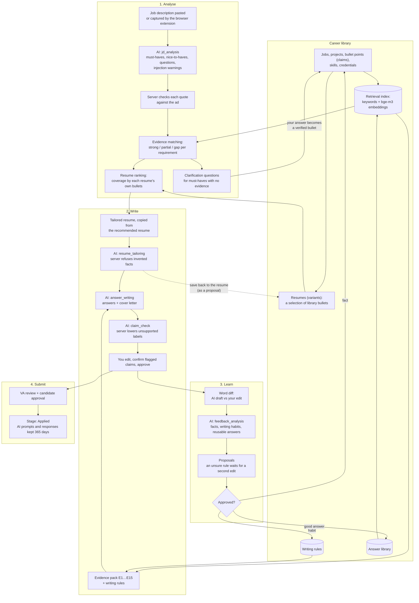
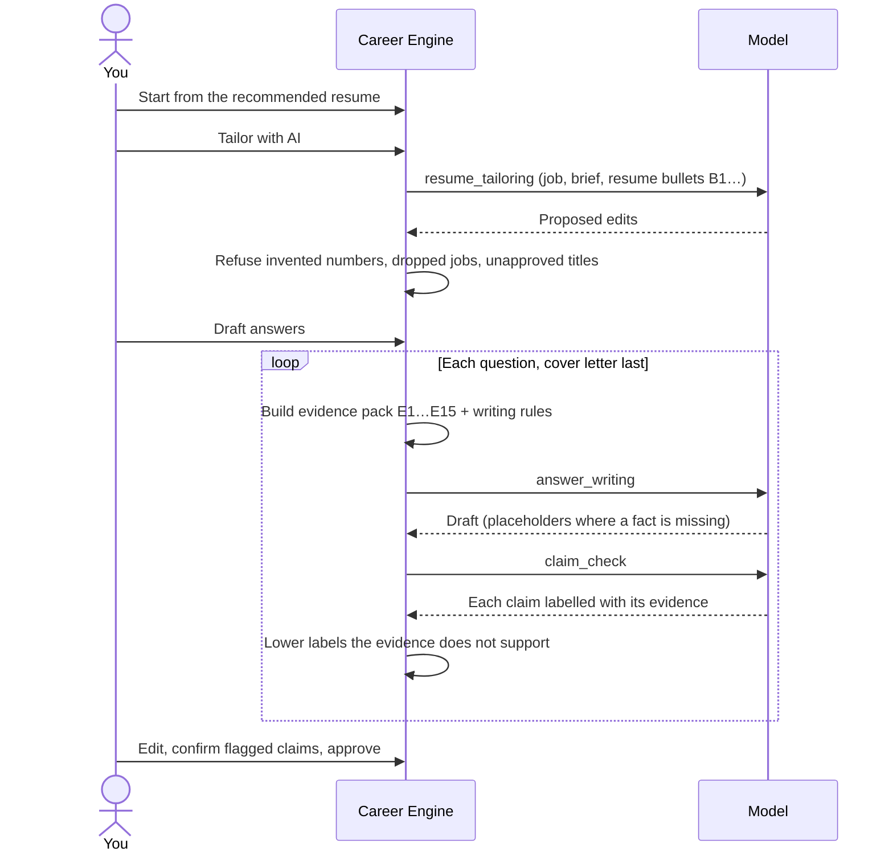
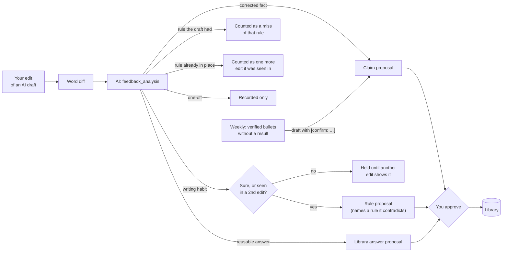

# How Career Engine works

> As built. The planning documents (PLAN.md and 01–07) describe the intended design; this page describes the flow the code runs today, with links to where each step lives.

Career Engine keeps one career library (jobs, projects, bullet points, skills, writing rules, reusable answers) and uses it for every application. Each application takes from the library through analysis and writing, and adds to it through clarifications and the lessons in your edits. Nothing reaches the library, a resume or an employer without a person approving it.

## The whole flow



## 1. Analyse

One AI call per job description, then searches only.

| Step | What happens | Code |
|---|---|---|
| Analysis | The model reads the ad and returns a brief: summary, must-haves and nice-to-haves (each with a quote), application questions, red flags, injection warnings. An ad too long for the model's window is read from the start, and the brief says how much was read. | [AnalyseJobApplication](../app/Jobs/AnalyseJobApplication.php) |
| Server checks | Each requirement's quote is looked up in the ad (`found`, `close`, `not_found`), and the server scans for prompt-injection text of its own. | [BriefChecker](../app/Domain/Applications/BriefChecker.php) |
| Evidence matching | Each requirement is searched in the whole library and rated: `strong` (a verified bullet or approved answer matches), `partial` (only unverified facts or summaries), `gap` (nothing). | [EvidenceMatcher](../app/Domain/Applications/EvidenceMatcher.php) |
| Resume ranking | Each requirement is searched again among each resume's own bullets. Resumes rank by must-haves strongly covered, then partly covered, then nice-to-haves, then default and name. A requirement the resume does not show is marked either as in your library (add it while tailoring) or as nowhere in it (a real gap, not something to invent). | [ResumeRanker](../app/Domain/Applications/ResumeRanker.php) |
| Clarifications | A must-have with no evidence opens a question. Your answer is saved as a bullet point: verified for the candidate, proposed for a VA. | [ClarificationService](../app/Domain/Applications/ClarificationService.php) |

"Refresh evidence" on the analysis page re-runs the matching and the ranking against the current library and resumes, without calling the model.

## 2. Write



| Step | What happens | Code |
|---|---|---|
| Tailored resume | A copy of the chosen resume for this job. The AI proposes a title, summary, bullet choice, order and wording; the server keeps only what the library supports and reports what it refused. | [TailorApplicationResume](../app/Jobs/TailorApplicationResume.php), [ResumeTailor](../app/Domain/Applications/ResumeTailor.php) |
| Evidence pack | Up to 15 facts, numbered E1…: the analysis matches for each requirement plus a search on the question. A cover letter leads with the tailored resume's bullets, in resume order. | [EvidencePackBuilder](../app/Domain/Applications/EvidencePackBuilder.php) |
| Answer | Written in your voice from the pack and your writing rules, within the question's limit. A fact the pack lacks becomes a `[confirm: …]` placeholder, which blocks approval until it is filled. A single paragraph can be redrafted on its own. | [GenerateAnswerDraft](../app/Jobs/GenerateAnswerDraft.php) |
| Claim check | Every claim is labelled `verified`, `inferred`, `proposed` or `hypothetical`, with its evidence. The server lowers a label the evidence does not carry (for example a number not in the source), and you confirm flagged claims before approving. | [CheckAnswerClaims](../app/Jobs/CheckAnswerClaims.php), [ClaimGroundingValidator](../app/Domain/Ai/ClaimGroundingValidator.php) |
| Traceability | Each AI version keeps the evidence it was given, the writing rules as worded then, the job description and analysis it used, and how the evidence was searched. | [AiAnswerService](../app/Domain/Applications/AiAnswerService.php) |

## 3. Learn



| Step | What happens | Code |
|---|---|---|
| Feedback analysis | Runs when an edited AI draft is approved, or when asked. The model reads the diff, your rules and the held rules, and names a rule a new one repeats or contradicts. | [AnalyseFeedback](../app/Jobs/AnalyseFeedback.php), [FeedbackAnalyser](../app/Domain/Feedback/FeedbackAnalyser.php) |
| Server checks | A corrected fact may only use numbers you wrote. Rules only similar to one another are never merged by the server. A contradiction is offered as a replacement, never applied by itself. | [FeedbackAnalyser](../app/Domain/Feedback/FeedbackAnalyser.php) |
| Proposals | Facts, rules and answers wait for approval: by the candidate, or by a VA alone for a VA's personal writing habit. | [ProposalService](../app/Domain/Knowledge/ProposalService.php), [ProposalApplier](../app/Domain/Knowledge/ProposalApplier.php) |
| Achievement suggestions | Weekly, verified bullets that describe a duty without a result get a question and a draft with placeholders. | [AchievementSuggester](../app/Domain/Knowledge/AchievementSuggester.php) |

## 4. Submit

A VA can prepare an application and submit it for review; the candidate approves the tailored resume and every answer. Moving an application to a submitted stage (Applied, Interviewing, Offer) records `applied_at`, and keeps the AI prompts and responses behind it for `ai.submitted_payload_retention_days` (365) instead of the usual 14 ([SubmittedWorkRetention](../app/Domain/Applications/SubmittedWorkRetention.php)).

## The AI calls

Every call goes through [AiGateway](../app/Domain/Ai/AiGateway.php): one route per task, a monthly budget guard for paid models, schema validation with one repair attempt, a `generation_runs` row (model, prompt version, tokens, latency, status), and an encrypted copy of the prompt and response. A call with an idempotency key returns the stored result instead of running twice.

| Task | When | Ollama default | Claude option | Size |
|---|---|---|---|---|
| `jd_analysis` | Each analysis | qwen2.5:3b | claude-haiku-5-5 | Medium in, medium out |
| `resume_tailoring` | "Tailor with AI" | qwen2.5:7b | claude-sonnet-5-5 | Long in, short out |
| `answer_writing` | Each answer, cover letter or paragraph redraft | qwen2.5:7b | claude-sonnet-5-5 | Long in, long out: the largest cost |
| `claim_check` | After each whole AI draft | qwen2.5:3b | claude-haiku-5-5 | Short, structured |
| `feedback_analysis` | Each edited AI draft | qwen2.5:3b | claude-sonnet-5-5 | Medium |
| `achievement_suggestions` | Weekly | qwen2.5:3b | claude-haiku-5-5 | Short |

Searching, matching, ranking, clarifications and retention make no AI call. Embeddings for search always run locally on Ollama (`bge-m3`). Generation runs on Ollama unless a task is given `AI_<TASK>_PROVIDER=claude` and `AI_ALLOW_EXTERNAL=true` is set; see [ai-setup.md](ai-setup.md).

## Background work

Every AI job waits on a queue chosen by where its task runs and whether someone is waiting ([AiQueue](../app/Domain/Ai/AiQueue.php)). A worker drains its first queue before the next.

| Queue | Jobs | Workers |
|---|---|---|
| `local-now` | Analysis, embeddings, "Refresh evidence", and any task routed to Ollama that someone is waiting for | 1: the tasks share one GPU |
| `local-bulk` | Weekly achievement suggestions, "Draft all" and learning from edits while on Ollama | the same worker |
| `claude-now` | Tasks routed to Claude that someone is waiting for: an answer, a redraft, tailoring, claim checks | 2 |
| `claude-bulk` | "Draft all" and learning from edits on Claude | the same workers |
| `default` | Re-indexing the library (no AI) | 1 |

```
php artisan queue:work --queue=local-now,local-bulk
php artisan queue:work --queue=claude-now,claude-bulk     # twice
php artisan queue:work --queue=default
php artisan schedule:work
```

The scheduler also picks up work saved by Career VA, which writes to the shared database and cannot queue jobs: every 10 minutes it analyses new applications that have a job description (`app:analyse-new-applications`), and daily it keeps the AI payloads of applications in a submitted stage (`app:retain-submitted-work`). AI work never stays stuck: when the queue gives up on a job (a killed worker, a timeout), the job's `failed()` handler marks its analysis, draft, tailoring, claim check or edit analysis as failed with a message, so it can be asked for again. Every 15 minutes `app:fail-stale-ai-work` ends anything still *running* past `ai.run_stale_after_minutes` (30), for when the PC was switched off mid-job. Queued work is left alone: it may rightly wait while the PC is off.

With the data on Neon, the queue tables can live on local Postgres (`DB_QUEUE_CONNECTION=local_queue`, see `.env.example`), so polling workers do not keep Neon awake.

Prompt and model changes are checked against a fixed set of synthetic samples: `php artisan app:compare-llm --baseline=<batch>` fails when a new batch does worse than the baseline (see [LlmComparison](../app/Domain/Ai/LlmComparison.php) and `tests/Eval/fixtures/llm-comparison.php`).
