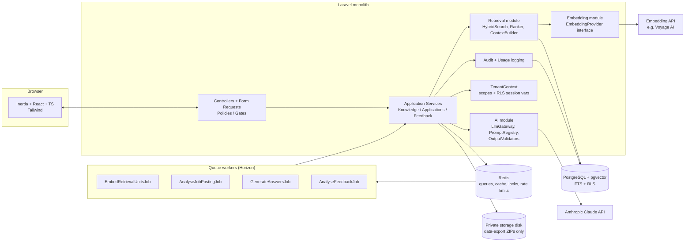
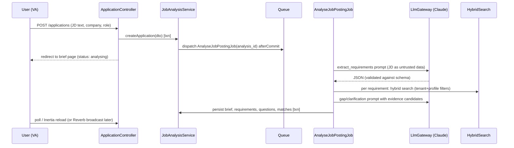
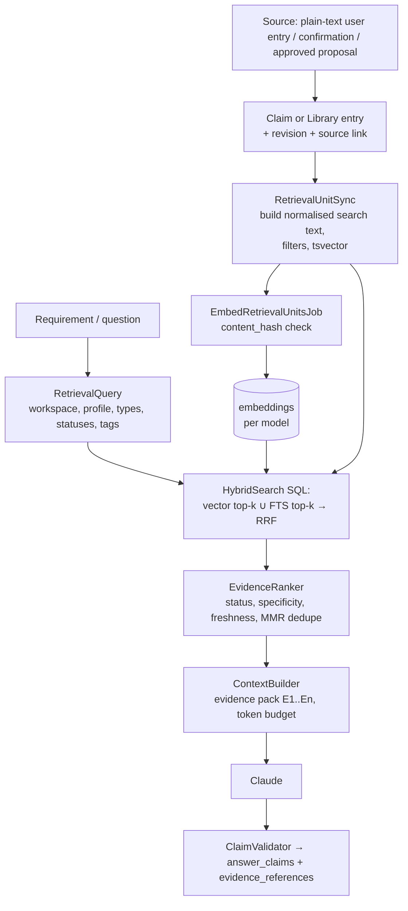
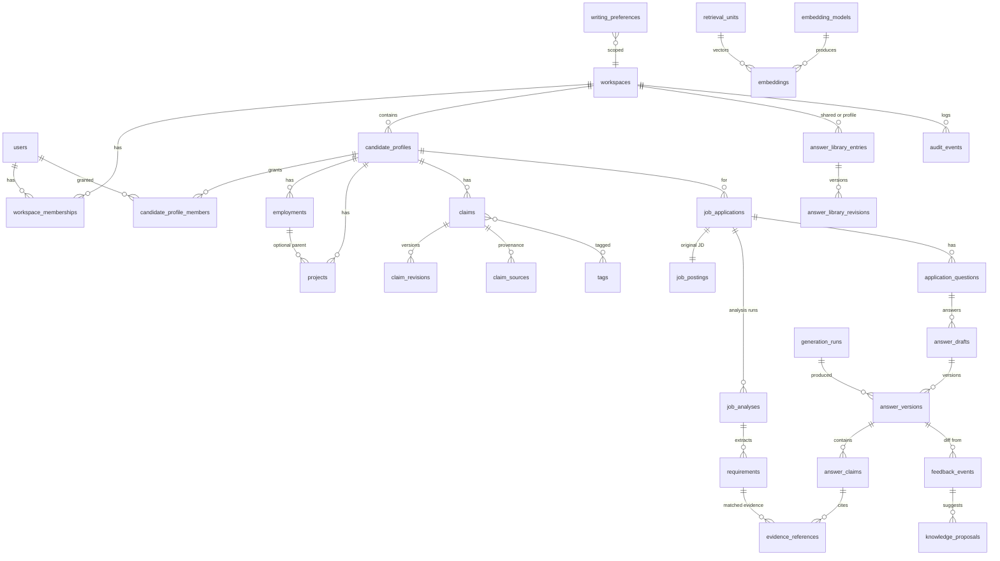

# AI Job Application Knowledge Engine — Engineering Plan

> Status: planning only. No application code yet. Project: `career-engine` (Laravel 13 + Inertia 3 / React 19 / TS starter kit).
> Items marked **[VERIFY]** are version-sensitive and must be checked against official docs before coding.

## Context

The user and their virtual assistants (VAs) prepare many job applications. Generic cover-letter generators produce unsupported, repetitive text and forget everything between applications. The goal is a Laravel + Inertia/React + PostgreSQL/pgvector platform that:

- keeps a **persistent, provenance-tracked career knowledge base**,
- analyses each job description into a structured **application brief**,
- generates answers using **Evidence-First + Creative Enhancement**, with every important claim labelled `verified | inferred | proposed | hypothetical` and linked to evidence,
- **learns from approved edits** without silently corrupting canonical facts,
- supports a **shared VA workspace** with strict tenant isolation,
- can grow into a multi-team SaaS.

---

# Deliverable 1 — Product and scope definition

## 1.1 Goals
1. Cut time from "pasted job description" to "approved, copy-ready answers" to **< 20 minutes** of human time for a typical application (5 questions + cover letter).
2. Every factual statement about the candidate in a final answer is either backed by verified evidence or visibly flagged.
3. Knowledge improves over time through **explicit, approved** updates, with full history.
4. VAs can do most of the preparation work; the candidate approves facts and final output.
5. No cross-workspace data leakage — enforced server-side at query, embedding and retrieval level.

## 1.2 Non-goals (MVP)
- Automatic submission to job portals, browser automation, scraping of job boards.
- Model fine-tuning.
- Billing, self-serve SaaS signup, public marketing site.
- Real-time collaborative (Google-Docs-style) editing — optimistic locking only.
- Mobile apps; email/calendar integrations; ATS integrations.
- Multi-LLM-provider routing (abstraction exists, only Claude implemented).

## 1.3 Personas and permissions (MVP: deliberately simple)

MVP is **personal use**: exactly **1 candidate (you) + up to 3 VAs**, one workspace, one candidate profile. Only two roles:

| Role | Who | Can do |
|---|---|---|
| `candidate` | You (also the admin) | Everything: manage VAs, settings, AI budget, verify facts, approve/reject all proposals, approve final answers, export/delete data |
| `va` | Up to 3 virtual assistants | Create applications, paste/group JDs, run analysis/generation, edit drafts, submit for review, **edit verified facts only as proposals** (never directly), propose new facts/answers/preferences |

Hard rules:
- Only the `candidate` can move a claim to `verified` or approve a knowledge proposal.
- A VA "editing" a verified fact creates a `knowledge_proposal(revise_claim)`; the canonical claim is unchanged until the candidate approves.
- Seat limit enforced server-side: max 3 active `va` memberships (config `app.max_vas = 3`).
- VA accounts are created by the candidate (invite link or direct creation) — no self-signup.

Future-proofing kept cheap: tables still carry `workspace_id` and `candidate_profile_id` so multi-team SaaS later is an additive change, but the MVP UI never exposes workspaces/profiles and there is no profile-level access control, reviewer, or viewer role.

## 1.4 Core workflows
1. **Onboard knowledge**: type or paste career history as plain text into UI forms (employments, projects, credentials, one statement per claim, or bulk-add one claim per line) plus standard question/answer pairs for the answer library → candidate verifies/approves → verified knowledge base, usable (copy-ready answers) before any AI feature exists. No file uploads, no document parsing, no AI extraction (D8).
2. **New application (fast path)**: paste JD (+ URL, company, role, deadline) → analysis job → review brief (requirements, questions, evidence matches, gaps) → answer clarification questions → generate → edit with evidence panel → resolve flagged claims → approve → copy/export.
3. **Achievement discovery**: AI flags thin records ("API integration, no outcome") → asks targeted questions → candidate confirms/revises/rejects → confirmed items become verified claims.
4. **Feedback learning**: edited answer → diff analysis → classified suggestions (fact correction / reusable answer / writing preference / one-off) → approval queue → versioned knowledge.
5. **JD collections**: as you apply, JDs are grouped into named collections (e.g. "Laravel backend roles", "Agency roles"); a collection can be flagged `use_for_eval` so its JDs + your approved answers become evaluation cases.
6. **VA workflow**: candidate assigns application to VA → VA prepares → submits for review → candidate approves or requests changes → marked submitted externally.

## 1.5 MVP vs later

| MVP (Phase 1) | Phase 2 | Phase 3 (SaaS) |
|---|---|---|
| Auth, 1 candidate + ≤3 VAs, two roles | Reviewer role, multiple candidate profiles | Multiple workspaces, self-serve signup, billing, SSO, Postgres RLS |
| Manual knowledge entry via plain-text UI forms (no file uploads) | Portfolio URL import, LinkedIn export import | Per-tenant encryption keys |
| Claims with verification + provenance + revisions | Duplicate merge UI with semantic clustering | Data residency options |
| JD analysis → brief | JD import from URL (fetched server-side, sanitised) | Browser extension for copy-fill |
| Evidence-first generation, claim labels, evidence panel | Reranker model, retrieval tuning UI | Graph agent framework if justified (see ADR-4) |
| Achievement suggestions + approval | Interview prep mode | |
| Feedback diff → proposals → approval queue | Writing-style analytics | |
| Assignment, statuses, deadlines, activity | Notifications (email/Slack) | |
| Copy-to-clipboard + plain-text export | Markdown/DOCX/PDF export | |
| Usage/cost tracking, **monthly AI budget ceiling**, audit log, data export/delete | Eval dashboard in-app | |
| JD records grouped into collections as you apply (feeds eval set) | | |

## 1.6 Key risks and assumptions

Risks:
| Risk | Mitigation |
|---|---|
| LLM labels an invented claim as `verified` | Server-side validator: `verified` only allowed if the claim cites a retrieved record whose status is `verified`; otherwise downgraded to `proposed` and flagged |
| Fabricated citations | Citations must reference IDs from the supplied context set; unknown IDs rejected |
| Proposed claims "laundering" into facts via reuse | Generated answers are never indexed as evidence; only human-confirmed claims become `verified` |
| Cross-tenant leakage via vector search | Tenant filter inside the SQL query + RLS defence-in-depth + automated leakage tests |
| Prompt injection in pasted JDs | Untrusted-content wrapping, no action-capable tools, schema validation, human approval for all writes |
| Cost creep | Per-run token logging, per-workspace monthly budget cap, prompt caching **[VERIFY]**, cheaper model for JD requirement extraction/classification |
| Solo-developer scope | Strict milestone ordering, MVP cut list, spikes before commitments |

Confirmed decisions (2026-10-20):
- D1. Personal use: 1 candidate + max 3 VAs; low volume (< 50 applications/month assumed).
- D2. Data residency / GDPR constraints: none beyond normal good practice for MVP; hosting region free choice.
- D3. Standard Anthropic and embedding-provider data retention is acceptable (no zero-retention arrangement needed).
- D4. Monthly AI budget ceiling is required (see 4.4 "Budget guard").
- D5. VAs may edit verified facts **only as proposals**.
- D6. Export format: **plain text** only (plus copy-to-clipboard).
- D7. Evaluation set: you will group real JD records as you apply; these become the real-world eval set alongside synthetic CI fixtures.
- D8. **Plain-text input only**: every input (career knowledge, JDs, questions, answers, preferences) is typed or pasted as plain text in the UI. No PDF/DOCX/file uploads, no text extraction from files, no AI claim extraction from documents.

Remaining assumptions:
- A1. Content is English.

## 1.7 Open questions
1. Initial monthly AI budget value — plan default is **US$30/month** (warn at 80%, hard-stop at 100%, candidate can raise it in Settings). Adjust if you have a number in mind.
2. Should VAs see the AI usage/cost page, or only the candidate? (Plan default: candidate only.)

---

# Deliverable 2 — Architecture

## 2.1 System diagram



Single deployable Laravel app; web and worker processes from the same codebase. All input arrives as plain text from UI forms (D8) — there is no file-upload or document-ingestion path. No separate retrieval service, Python backend, vector DB, or agent framework in MVP.

## 2.2 Component responsibilities (module layout)

Use domain folders under `app/` (no package/modules framework needed):

```
app/
  Http/Controllers/…            thin: authorise, validate, call service, return Inertia
  Http/Requests/…               validation
  Policies/…                    per-model authorisation
  Domain/
    Tenancy/                    Workspace, Membership, TenantContext, BelongsToWorkspace trait, RLS middleware
    Knowledge/                  CandidateProfile, Employment, Project, Claim, ClaimRevision, Source,
                                AnswerLibraryEntry, WritingPreference; KnowledgeService, DuplicateDetector
    Retrieval/                  RetrievalUnit, Embedding, EmbeddingModel; RetrievalUnitSync,
                                HybridSearch, EvidenceRanker, ContextBuilder, RetrievalQuery DTO
    Ai/                         LlmClient (interface), AnthropicLlmClient, PromptRegistry, PromptTemplate,
                                GenerationRun, StructuredOutput validators, CostCalculator
    Embeddings/                 EmbeddingProvider (interface), VoyageEmbeddingProvider, FakeEmbeddingProvider
    Applications/               JobApplication, JobPosting, JobAnalysis, Requirement, ApplicationQuestion,
                                AnswerDraft, AnswerVersion, AnswerClaim, EvidenceReference;
                                JobAnalysisService, AnswerGenerationService, ClaimValidator, ExportService
    Feedback/                   FeedbackEvent, KnowledgeProposal; FeedbackAnalysisService, ProposalApplier
    Audit/                      AuditEvent, AuditLogger
  Jobs/                         queue jobs (thin; call services)
  Data/                         DTOs (spatie/laravel-data or plain readonly classes — decide in M1)
resources/js/
  Pages/…  Components/…  types/ (generated from DTOs)
prompts/                        versioned prompt templates (files in git) + JSON schemas
```

Rules: controllers never call the LLM directly; services own transactions; jobs are idempotent wrappers around services; only `Retrieval` builds vector/FTS SQL; only `Ai` talks to Anthropic.

## 2.3 Request and job flows

**JD analysis (async with progress):**


**Generation:** `POST /applications/{id}/generate` → `GenerateAnswersJob(application_id, question_ids, idempotency_key)` → for each question: RetrievalQuery → ContextBuilder (evidence pack with stable IDs `E1..En`) → Claude structured output → ClaimValidator → persist `answer_versions` + `answer_claims` + `evidence_references` in one transaction.

**Feedback:** saving a human edit creates a new `answer_version` (author=user). On "Approve" or explicit "Learn from my edits", dispatch `AnalyseFeedbackJob(feedback_event_id)` → Claude classifies diff → `knowledge_proposals` (status `pending`) → approval queue → `ProposalApplier` writes new revisions in a transaction.

## 2.4 RAG data flow



## 2.5 Key design decisions (summary; full ADRs in Deliverable 6)
- **Monolith** over services: one developer, low volume; module boundaries in code suffice.
- **Hybrid retrieval inside PostgreSQL** (one SQL query, reciprocal rank fusion) — no separate search service until measured need (see ADR-4 triggers).
- **Derived `retrieval_units` table** decouples canonical knowledge (claims, library answers, employment/project summaries) from search representation; can be rebuilt any time.
- **Claims as atomic facts** with append-only revisions — the unit of verification and citation.
- **Human-in-the-loop for every canonical write** originating from AI.
- **Async jobs for every LLM call** (no LLM calls in the web request path), so timeouts/retries are controlled.

---

# Deliverable 3 — Database design

## 3.1 Conventions
- PKs: `bigint` identity internally + `ulid` public id column for URLs (avoids enumeration). **Every tenant table has `workspace_id NOT NULL`** (denormalised on purpose for RLS, indexes and cheap filtering).
- Composite FKs `(workspace_id, x_id)` → `(workspace_id, id)` on key relationships so a row can never reference another workspace's row (requires `UNIQUE (workspace_id, id)` on parents). This is the cheapest strong isolation guarantee Postgres offers.
- Timestamps `timestamptz`. Soft deletes only where restore is a product feature (applications); knowledge uses `status = archived` + revisions instead.
- Optimistic locking: `lock_version int` on mutable heads (claims, answer_drafts, applications, proposals).
- Enums as `text` + `CHECK` constraints (easier migrations than PG enums).

## 3.2 ER diagram (core)



## 3.3 Table definitions (important columns)

### Identity & tenancy
- **users**: id, ulid, name, email (unique, citext), password, two_factor_*, is_active, last_login_at.
- **workspaces**: id, ulid, name, settings jsonb (default models), monthly_ai_budget_micros bigint (default 30_000_000 = US$30), budget_warn_pct smallint (default 80), created_by. MVP: exactly one row, created by a seeder/install command.
- **workspace_memberships**: id, workspace_id, user_id, role (`candidate|va`), created_by. `UNIQUE(workspace_id, user_id)`; partial unique `UNIQUE(workspace_id) WHERE role='candidate'` (exactly one candidate); VA seat limit (≤ 3 active) enforced in `MembershipService` inside a transaction with `FOR UPDATE` on the workspace row.
- **candidate_profiles**: id, ulid, workspace_id, user_id (the candidate's account), display_name, headline. `UNIQUE(workspace_id, id)`. MVP: one row.
- (Dropped for MVP: invitations table — candidate creates VA accounts directly and shares a password-reset link; candidate_profile_members; extra roles.)

### Career knowledge (canonical)
- **employments**: id, workspace_id, candidate_profile_id, employer_name, employer_normalized, title, employment_type, location, start_date, end_date (null=current), date_precision (`day|month|year`), summary, status (`verified|proposed|archived`), lock_version.
- **projects**: id, workspace_id, candidate_profile_id, employment_id (nullable), name, client_name (nullable — careful: confidential), role, start/end, summary, url, status, lock_version.
- **claims** — the atomic, citable unit:
  - id, ulid, workspace_id, candidate_profile_id
  - subject_type (`employment|project|education|certification|general`), subject_id (nullable)
  - kind (`responsibility|achievement|metric|skill|technology|qualification|domain|preference|other`)
  - current_revision_id (FK claim_revisions)
  - status (`verified|proposed|rejected|archived`) — **only verified claims can back a `verified` label**
  - origin (`user_entered|ai_suggested|feedback_derived|imported`)
  - normalized_hash (sha256 of normalised statement — exact-dup guard)
  - verified_by, verified_at, lock_version
  - Constraints: `CHECK (status <> 'verified' OR verified_by IS NOT NULL)`; partial unique `UNIQUE(candidate_profile_id, normalized_hash) WHERE status IN ('verified','proposed')`.
- **claim_revisions** (append-only): id, workspace_id, claim_id, revision_no, statement text, structured jsonb (e.g. `{metric: {value, unit, period}, technologies: []}`), date_from/date_to, change_reason, created_by, created_via (`manual|proposal:{id}|import`), created_at. `UNIQUE(claim_id, revision_no)`.
- **claim_sources** (provenance, many per claim): id, workspace_id, claim_id, claim_revision_id, source_type (`user_confirmation|project|employment|external_url|answer_version`), source_id, quote/excerpt (short span), confirmed_by, created_at. Note: `answer_version` source is allowed only to record *where it was first suggested*; it never satisfies verification on its own (enforced in `KnowledgeService::verify`, which requires a `user_confirmation` source).
- **tags**: id, workspace_id, kind (`skill|technology|domain|industry`), name, normalized_name. `UNIQUE(workspace_id, kind, normalized_name)`.
- **taggables**: tag_id, taggable_type, taggable_id, workspace_id.
- **education / certifications**: modelled as `subject_type` records in a small `credentials` table (id, workspace_id, profile_id, type, institution, name, awarded_on, status).

### No documents tables (D8)
There are no `documents` / `document_chunks` tables: nothing is uploaded or extracted. All knowledge is plain text stored directly on the canonical rows (`claim_revisions.statement`, `employments.summary`, `projects.summary`, library answer bodies). Longer context, such as a case study, goes into a project's `summary` as plain text.

### Reusable content
- **answer_library_entries**: id, workspace_id, candidate_profile_id (NULL = workspace-shared template), visibility (`profile|workspace`), question_pattern (canonical question text), category (`motivation|strengths|salary|behavioural|technical|...`), current_revision_id, status (`approved|draft|archived`), approved_by/at, lock_version. Merges the prompt's `question_templates` and `approved_answers`: a shared template is just an entry with no profile and placeholder-style content.
- **answer_library_revisions**: entry_id, revision_no, body, claim_ids bigint[] (claims the answer relies on), created_by, source (`manual|proposal:{id}`).
- **writing_preferences**: id, workspace_id, scope (`user|profile|workspace`), user_id / candidate_profile_id (per scope), rule text (e.g. "British spelling", "No 'passionate'"), kind (`tone|banned_phrase|format|spelling|structure`), status, examples jsonb, created_via. CHECK that exactly the right owner column is set for the scope.

### Retrieval (derived, rebuildable)
- **retrieval_units**: id, workspace_id, candidate_profile_id (nullable for workspace-shared), visibility, unit_type (`claim|library_answer|project_summary|employment_summary`), source_type, source_id, source_revision_id, status (copied from source: `verified|proposed|approved`), search_text, tsv `tsvector GENERATED ALWAYS AS (to_tsvector('english', search_text)) STORED`, tag_ids int[], employer_normalized, date_to, specificity_score real, content_hash, is_active bool, updated_at. `UNIQUE(source_type, source_id)`.
- **embedding_models**: id, provider, model, dimensions, distance (`cosine`), input_type_doc, input_type_query, is_active_for_write, is_active_for_read, created_at.
- **embeddings**: id, workspace_id, retrieval_unit_id, embedding_model_id, content_hash, embedding `vector` (no fixed dimension at column level), created_at. `UNIQUE(retrieval_unit_id, embedding_model_id)`.

### Applications
- **jd_collections**: id, workspace_id, name, description, use_for_eval bool, created_by. `UNIQUE(workspace_id, name)`.
- **jd_collection_items**: jd_collection_id, job_application_id, added_by, added_at. PK(collection, application). Many-to-many so one JD can sit in several groups.
- **job_applications**: id, ulid, workspace_id, candidate_profile_id, company_name, role_title, source_url, location, employment_type, salary_text, status (`draft|analysing|ready_for_generation|in_progress|in_review|changes_requested|approved|submitted|interviewing|offer|rejected|withdrawn|archived`), owner_user_id, assigned_user_id, deadline_at, submitted_at, notes, lock_version, deleted_at.
- **job_postings**: id, workspace_id, job_application_id (unique), raw_text (verbatim, immutable), raw_sha256, captured_at, captured_by.
- **job_analyses**: id, workspace_id, job_application_id, generation_run_id, prompt_version, brief jsonb (validated: summary, employer language, seniority, must-haves, nice-to-haves, red flags, injection_warnings), status, created_at. Multiple per application (re-analysis); `job_applications.current_analysis_id`.
- **requirements**: id, workspace_id, job_analysis_id, kind (`must|preferred|responsibility|employer_value`), text, importance smallint, verbatim_quote.
- **application_questions**: id, workspace_id, job_application_id, origin (`extracted|manual|cover_letter`), prompt_text, word_limit, char_limit, position, status.
- **clarification_requests**: id, workspace_id, job_application_id, question_text, reason, related_requirement_id, answer_text, answered_by, converted_claim_id (if the answer became a proposed claim).

### Answers, versions, claims, evidence
- **answer_drafts**: id, workspace_id, application_question_id, current_version_id, approved_version_id, status (`generating|draft|in_review|approved`), lock_version.
- **answer_versions** (append-only): id, workspace_id, answer_draft_id, version_no, body text, author_type (`ai|user`), author_user_id, generation_run_id, parent_version_id, created_at. `UNIQUE(answer_draft_id, version_no)`.
- **answer_claims**: id, workspace_id, answer_version_id, span_start, span_end, text, classification (`verified|inferred|proposed|hypothetical`), model_classification (what the LLM said, for eval), validation_flags text[] (e.g. `downgraded_no_verified_evidence`, `metric_without_source`), resolution (`open|accepted|removed|converted_to_proposal`), resolved_by.
- **evidence_references**: id, workspace_id, referrer_type (`answer_claim|requirement`), referrer_id, retrieval_unit_id, source_type, source_id, source_revision_id (pin the exact revision cited), relevance_score, rank.

### Feedback & proposals
- **feedback_events**: id, workspace_id, answer_draft_id, from_version_id, to_version_id, user_id, diff jsonb (computed server-side), analysis jsonb (Claude output), generation_run_id, status (`pending_analysis|analysed|failed`).
- **knowledge_proposals**: id, ulid, workspace_id, candidate_profile_id, origin (`feedback|achievement_suggestion|clarification|manual`), origin_id, proposal_type (`create_claim|revise_claim|archive_claim|create_library_answer|revise_library_answer|create_writing_preference|one_off_no_action`), target_type, target_id, target_revision_id (base revision — for conflict detection), payload jsonb (validated per type), rationale, status (`pending|approved|rejected|superseded|conflict`), proposed_by_user_id / proposed_by_run_id, decided_by, decided_at, decision_note, lock_version.
  - Partial unique: `UNIQUE(target_type, target_id, proposal_type) WHERE status='pending'` for revise types — prevents conflicting concurrent pending edits; new ones mark older as `superseded`.

### Operations
- **generation_runs**: id, ulid, workspace_id, purpose (`jd_analysis|answer_generation|feedback_analysis|achievement_suggestion|grounding_check`), prompt_key, prompt_version, model, request_hash, idempotency_key (unique), input_tokens, output_tokens, cache_read_tokens, cache_write_tokens, cost_micros, latency_ms, status (`queued|running|succeeded|failed|invalid_output`), error_code, attempt, created_by. Store prompt/response bodies **only** in an encrypted, TTL'd `generation_payloads` table (debug, default 14-day retention) — not in logs.
- **audit_events**: id, workspace_id, actor_user_id, actor_type (`user|system|job`), action (`claim.verified`, `proposal.approved`, `data_export.downloaded`, `member.role_changed`, …), subject_type, subject_id, metadata jsonb (no content bodies), ip_hash, created_at. Append-only (revoke UPDATE/DELETE from app role). Doubles as activity history.

## 3.4 How the schema supports the requirements
- **Provenance**: `claim_sources` (+ pinned `claim_revision_id`), `evidence_references.source_revision_id`, `knowledge_proposals.origin`.
- **Verification status**: `claims.status` + `verified_by/at` CHECK; `answer_claims.classification` + validator flags.
- **Versioning**: append-only `*_revisions`/`answer_versions`; heads carry `current_revision_id` + `lock_version`.
- **Private vs shared**: `candidate_profile_id` (private to profile) vs `NULL` + `visibility='workspace'` (shared templates); `writing_preferences.scope` for user-level.
- **Embedding model/dimension changes**: `embedding_models` + per-model rows in `embeddings`; untyped `vector` column with per-model partial expression HNSW indexes (pgvector supports indexing an expression cast like `(embedding::vector(1024))` with `WHERE embedding_model_id = N` — **[VERIFY]** current pgvector README; dims limit for HNSW on `vector` is 2,000, `halfvec` 4,000 **[VERIFY]**).
- **Efficient hybrid retrieval**: one table (`retrieval_units`) with GIN on `tsv`, btree on `(workspace_id, candidate_profile_id, unit_type, status)`, GIN on `tag_ids`, HNSW per model on `embeddings`.
- **Concurrent edit/approval**: `lock_version` checks (409 on mismatch with merge UI), `SELECT … FOR UPDATE` on proposal + target in `ProposalApplier`, base-revision conflict detection.
- **Tenant isolation**: `workspace_id` everywhere, global scope, policies; RLS later (3.6).

## 3.5 Indexes & pgvector strategy
- `retrieval_units`: `GIN(tsv)`; `BTREE(workspace_id, candidate_profile_id, is_active, unit_type, status)`; `GIN(tag_ids)`.
- `embeddings`: `HNSW ((embedding::vector(D)) vector_cosine_ops) WHERE embedding_model_id = N` per active model; `BTREE(workspace_id, embedding_model_id)`.
- Filtered ANN caveat: HNSW + strict WHERE filters can return fewer than k rows. At MVP scale (thousands of units per workspace) recommend: **exact (brute-force) scan within the tenant partition** is fast enough; enable HNSW + `hnsw.ef_search` / iterative index scans (pgvector ≥ 0.8 `hnsw.iterative_scan` **[VERIFY]**) once units > ~50k. Spike S3 measures this.
- Other: `job_applications(workspace_id, status, deadline_at)`, `(workspace_id, assigned_user_id, status)`; `knowledge_proposals(workspace_id, status, created_at)`; `audit_events(workspace_id, created_at desc)`; `claims(candidate_profile_id, status, kind)`; trigram index on `claims` statement (via `claim_revisions`) for near-duplicate detection (`pg_trgm`).

## 3.6 Access control & tenant isolation (MVP: simple, future-proof)
With one workspace and one candidate, the real MVP boundary is **role** (candidate vs VA) and **authentication** (nobody else sees anything). Plan:
1. **Laravel authorisation** (MVP, primary): policies + gates for every action (`verify-claim`, `approve-proposal`, `manage-vas`, `manage-budget` → candidate only). All routes behind `auth` + 2FA for the candidate.
2. **Tenant scoping kept in code from day one, cheaply**: every tenant table has `workspace_id`; a `BelongsToWorkspace` trait sets it on create and a global scope filters by the current workspace (resolved from the user's single membership — no `/w/{workspace}` URLs in MVP). Retrieval SQL always filters by `workspace_id` + `candidate_profile_id`. Composite FKs where cheap.
3. **PostgreSQL RLS: deferred to Phase 3** (multi-team SaaS). With a single tenant it adds friction without protecting against a realistic MVP threat. The `workspace_id` columns + scope make adding RLS later a migration + middleware, not a redesign. A small test suite with a second seeded workspace still runs in CI so the scoping code stays correct.

## 3.7 Data lifecycle & migrations
- Migrations via Laravel; raw SQL statements for pgvector/RLS/partial indexes (`DB::statement`). `CREATE EXTENSION vector, pg_trgm, citext` in the first migration (requires managed-PG support **[VERIFY]**).
- Backups: managed PG daily snapshots + PITR (≥ 7 days); export ZIPs auto-deleted after 24h; quarterly restore drill (documented runbook).
- Retention: `generation_payloads` 14 days; `audit_events` 2 years; deleted applications purged after 30 days.
- **Answer export (MVP)**: plain text only — per answer copy button, and "Export application" producing a `.txt` (question headings + final approved answers + cover letter). No Markdown/DOCX/PDF in MVP.
- **Data export (backup/portability)**: candidate-only ZIP (JSON of all knowledge + revisions + applications) via queued job, signed URL, expires in 24h.
- **Deletion**: profile/workspace deletion job — hard deletes rows (cascade), export files, embeddings, generation payloads; writes a tombstone audit event without content. Note Anthropic/Voyage-side retention is governed by their policies **[VERIFY]**.
- Re-embedding: new `embedding_models` row → backfill job → flip `is_active_for_read` → drop old vectors after a grace period.

---

# Deliverable 4 — AI and RAG design

## 4.1 Knowledge entry (plain text only — D8)
No file uploads, no PDF/DOCX parsing, no chunking and no AI claim extraction. Knowledge enters the system only through UI forms.
1. **Structured forms**: employments, projects, credentials, writing preferences and library answers are created through Inertia forms with plain-text fields (`<textarea>` / `<input>`, no rich text).
2. **Answer library**: question + answer pairs entered by hand (or several pasted at once, separated by a `---` line), with category and optional linked claims. Candidate entries are `approved`, VA entries stay `draft` until the candidate approves them. They are indexed as `library_answer` retrieval units from M6 on.
3. **Claims**: one statement per claim, attached to an employment/project/credential or `general`. **Bulk add**: paste a list into a textarea and each non-empty line becomes a draft claim under the chosen subject. This is a deterministic split with no AI, previewed before saving.
4. **Server-side normalisation** (Form Requests): trim, Unicode NFC, collapse whitespace, strip control and zero-width characters, length limits (claim ≤ 1,000 chars, summaries ≤ 5,000, JD ≤ 50,000).
5. **Status on save**: claims the candidate enters can be saved as `verified` directly, with `claim_sources(user_confirmation)`. Claims a VA enters are saved as `proposed`, and a VA's change to a verified claim becomes a `revise_claim` proposal (D5).
6. **Duplicate detection** before insert: exact `normalized_hash`; near-dup via `pg_trgm similarity > 0.6` within same subject, then embedding cosine > 0.92 **[tune in eval]** → surfaced as "possible duplicate of …: merge / keep both".

## 4.2 What to embed
| Embed | Why |
|---|---|
| Claims (verified + proposed, current revision; text includes subject context: "At Acme (2021–23), Senior Dev: …") | Primary evidence |
| Approved library answers (question_pattern + body) | Reuse and style |
| Employment/project summaries | Broad context matching; fallback evidence for context not yet split into claims |
| **Do not embed**: generated answer versions (prevents laundering), audit/ops data, job postings (they're queries, embed transiently or cache per analysis), writing preferences (always included by rule, not retrieved), rejected/archived items |

Embedding versioning: `content_hash = sha256(model_id + search_text)`; `EmbedRetrievalUnitsJob` skips when hash unchanged. Regenerate when: source revision changes, `search_text` template version changes (bump `RETRIEVAL_TEXT_VERSION`), or model changes (backfill).

**Embedding provider recommendation**: Anthropic does not offer an embeddings API; their docs point to **Voyage AI** **[VERIFY current model names, e.g. voyage-3.5 / voyage-3.5-lite, dimension options, input_type support, pricing]**. Alternative: OpenAI `text-embedding-3-small`. `EmbeddingProvider` interface: `embedDocuments(array $texts): EmbeddingBatch`, `embedQuery(string): Vector`, `model(): EmbeddingModelSpec`. `FakeEmbeddingProvider` (deterministic hash vectors) for tests.

## 4.3 Hybrid retrieval and ranking
**Query construction** per requirement/question: text = requirement + question + key employer terms; filters from `RetrievalQuery` DTO: `workspace_id` (mandatory), `candidate_profile_id` (mandatory unless shared-only), `allowed_visibility`, `unit_types`, `statuses` (default `verified, proposed, approved`), optional tag/employer/date filters.

**SQL (single round trip, CTEs):**
1. `semantic`: top 40 by cosine distance from `embeddings` joined to filtered `retrieval_units`.
2. `lexical`: top 40 by `ts_rank_cd(tsv, websearch_to_tsquery('english', :q))`.
3. `fused`: Reciprocal Rank Fusion `Σ 1/(60 + rank)`; return top 30 with both ranks.

**App-side reranking (`EvidenceRanker`)**: `final = rrf_norm * w1 + status_boost (verified 1.0, approved 0.9, proposed 0.4) * w2 + specificity (has metric/named tech/date) * w3 + freshness decay (half-life ~5y on date_to) * w4`. Weights in config, tuned by eval. Then **MMR**-style dedupe: drop items with cosine > 0.9 to an already-selected item or same `source_id` lineage (a claim vs. its parent employment/project summary — prefer the claim). Cap: ~8 items per requirement, ~25 per generation, token budget ~6k for evidence.

Optional later: Voyage rerank model **[VERIFY]** or Claude-based rerank — only if eval shows precision gap.

**Access control before LLM**: filters are in the SQL; `ContextBuilder` asserts every item's `workspace_id`/`candidate_profile_id` matches the run's context (throws + audit on mismatch). RLS backs it up.

**Postgres vs separate service**: implement **directly in PostgreSQL**. Revisit when: >1M units, p95 retrieval > 300 ms after tuning, need for learned sparse retrieval / cross-language, or multi-region. Even then, first step is a read replica, not a new datastore.

## 4.4 Claude prompt architecture
- **Prompt registry**: prompts as files in `prompts/{key}/v{n}.md` + `schema.json`; `PromptRegistry::get('answer_generation', version)`; version + model recorded on every `generation_run`. Changing a prompt = new version file (immutable once used in prod).
- **Budget guard (monthly ceiling)**: `workspaces.monthly_ai_budget_micros` (default US$30, editable by candidate in Settings). Before every LLM/embedding call, `BudgetGuard` sums `generation_runs.cost_micros` for the current calendar month (UTC) + an *estimated* cost of the pending call (input tokens counted/estimated × price, max_tokens × output price). ≥ 80% → warning banner + one email/notice to the candidate; ≥ 100% → new runs refused with a clear UI message (candidate can raise the ceiling). Check-and-reserve is atomic (Redis lock or `FOR UPDATE` on the workspace row) so concurrent jobs can't overshoot by more than one call. Embedding costs are included. Price table in `config/ai.php` **[VERIFY current prices]**.
- **Model config** (`config/ai.php`, overridable per workspace): e.g. generation/feedback analysis → `claude-sonnet-5-5`; JD requirement extraction/classification/grounding check → `claude-haiku-5-5`. **[VERIFY]** current model IDs, pricing, context limits via the claude-api reference before M4.
- **Structured outputs**: use Claude tool-use with a JSON-schema'd tool (or native structured-output feature if available **[VERIFY]**) and force the tool choice; then **always** validate server-side with a JSON schema validator (`opis/json-schema`) + typed DTO hydration. Invalid → one repair retry with validation errors → else `invalid_output` failure surfaced to user.
- **Message layout** (cache-friendly ordering **[VERIFY prompt-caching semantics]**):
  1. System: role, Evidence-First + Creative Enhancement policy, claim taxonomy, untrusted-content policy, output contract.
  2. Writing preferences (stable per workspace → cacheable).
  3. Application brief + evidence pack: `<evidence id="E3" type="claim" status="verified" source="claim:01H…">…</evidence>`.
  4. Untrusted JD excerpt inside `<job_description untrusted="true">…</job_description>`.
  5. Task: specific question, word/char limit, tone.
- **Generation output schema (per question)**:
  ```json
  {
    "answer": "string",
    "segments": [{"text": "...", "claims": [{"text": "...", "classification": "verified|inferred|proposed|hypothetical", "evidence_ids": ["E3"], "rationale": "..."}]}],
    "clarification_questions": [{"question": "...", "why": "...", "blocking": true}],
    "achievement_suggestions": [{"related_evidence_id": "E5", "prompt_to_user": "Did the integration reduce manual processing time? Roughly how much?", "candidate_metric": "hours saved per week"}],
    "self_check": {"unsupported_claims_present": false, "word_count": 230}
  }
  ```
- **Policy text (key rules)**: retrieve-then-write; prefer verified/approved; may construct answers and approaches (label `hypothetical`), may reframe/transfer skills (`inferred`, must cite the verified basis), may suggest achievements (`proposed`, phrased as questions or placeholders like `[confirm: % reduction]` never as fact); never invent numbers, clients, employers, titles, dates, qualifications; banned-phrase list from writing preferences + a default list ("passionate", "fast-paced environment", "I am writing to express", "leverage synergies"…); tailor to employer language from the brief.

## 4.5 Claim classification & evidence tracking (server-side `ClaimValidator`)
For each claim from the model:
1. All `evidence_ids` must exist in the supplied pack → else strip IDs + flag `fabricated_citation`.
2. `verified` requires ≥1 cited item with status `verified`/`approved` → else downgrade to `proposed` + flag.
3. `inferred` requires ≥1 cited verified item → else downgrade to `proposed`.
4. Regex/heuristic detectors on answer text: numbers/percentages/currency, years, ALL-CAPS acronyms (certs), organisation names not present in evidence → any such token not found in cited evidence text → flag `unsupported_specific` (catches claims the model didn't declare).
5. Locate claim spans in `answer` (exact/fuzzy match) for highlighting; unlocatable → flag.
6. Optional **grounding check** pass (Haiku): "Does E3 support statement X? yes/partial/no" for verified/inferred claims — enabled when eval shows value.
7. Approval gate: an answer cannot be approved while it has `open` claims classified `proposed` or flagged — user must accept (keep as hedged wording), edit, remove, or "convert to proposal" (creates a `knowledge_proposal` for the candidate). Hypothetical claims are allowed but shown with a label.

## 4.6 Achievement suggestions
- Triggered (a) during generation (schema field above), (b) by a scheduled "knowledge health" job over claims of kind `responsibility` with no linked `achievement/metric` (Haiku, batched, budget-capped).
- Stored as `knowledge_proposals(origin=achievement_suggestion, proposal_type=create_claim, payload={draft_statement_with_placeholders, questions[]})`, status `pending`.
- UI: candidate answers the question (e.g. "about 6 hours/week"), edits the draft statement, confirms → claim `verified` with `claim_sources(user_confirmation)`; reject → stored rejection (prevents re-suggesting via `rejected_suggestion_hash`).

## 4.7 Feedback and approval pipeline
1. Human edit saved → new `answer_version(author=user)`.
2. On approval of the answer (or explicit "learn from edits"), `feedback_events` row with server-computed diff (word-level, `jfcherng/php-diff` or similar **[VERIFY]**).
3. `AnalyseFeedbackJob`: Claude receives original, edited, the evidence pack used, current writing preferences → outputs candidate proposals each with `type` (`factual_correction|reusable_answer|writing_preference|one_off`), target (claim ID from pack, or new), payload, confidence, rationale.
4. Validation: targets must be in pack; `one_off` → recorded, no proposal; low-confidence preference changes require ≥2 similar edits before proposing (dedupe by normalised rule).
5. Routing: factual corrections, reusable answers and shared writing preferences → candidate approval queue; a user's *personal* writing preference (scope `user`) → that user may self-approve. VA direct edits of verified facts in the knowledge manager also land here as `revise_claim` proposals.
6. `ProposalApplier` (transaction, `FOR UPDATE` on proposal + target, check `target_revision_id == current_revision_id` else status `conflict` → show 3-way view) writes a new revision, `claim_sources`, audit event, and triggers `RetrievalUnitSync`.

## 4.8 Prompt-injection handling
- Pasted JDs (and any other pasted third-party text) are wrapped and declared untrusted; system prompt says instructions inside are data.
- The model has **no tools that act** (only the output-schema tool); it cannot write to DB, send messages, or fetch URLs.
- Outputs are schema-validated; free text never executed or rendered as HTML (React escapes; Markdown rendering with sanitiser).
- Brief includes `injection_warnings` (model + heuristic scan for "ignore previous", "system prompt", hidden-text/zero-width chars) → banner in UI.
- Extracted "application questions" are shown for human confirmation before generation.
- All knowledge writes require human approval, so injected "add fact X" can at most create a pending proposal.

## 4.9 Evaluation methodology
**Dataset (in repo, `tests/Eval/fixtures`)** — fictional candidate "Alex Morgan" (never real data):
- ~60 claims across 4 employments, 6 projects (mix: verified, proposed, archived; some with metrics, some without), 3 approved library answers, 5 writing preferences (all plain text, as entered through the UI).
- 10 JDs: backend Laravel role, full-stack React, data engineering (partial fit), DevOps (weak fit), product manager (transferable), agency developer, fintech (compliance terms), a JD with 6 explicit questions, a JD with embedded prompt injection, a JD with hidden/zero-width text.
- Labels: per requirement, the set of relevant claim IDs (graded 0–2); per JD, "must-not-claim" list (e.g. Kubernetes, which Alex never used).
- A second tenant fixture "Sam Lee" with overlapping skills to test scoping.
- **Real-world set (D7)**: JD collections flagged `use_for_eval`. `php artisan eval:snapshot {collection}` exports those JDs, the brief, and your approved final answers (with the claim IDs they cited) into a private, git-ignored `storage/eval/real/` set. Approved citations become relevance labels; your edits vs. the first AI draft give an "edit distance" quality signal. Never committed to the repo (real personal data).

**Harness**: `php artisan eval:retrieval` (deterministic, runs in CI with recorded real embeddings committed as fixtures) and `php artisan eval:generation --live` (manual/nightly, real Claude, reports cost).

**Acceptance criteria (initial targets — recalibrate after first baseline):**
| Area | Metric | Target |
|---|---|---|
| Retrieval | Recall@8 of grade-2 evidence per requirement | ≥ 0.85 |
| Retrieval | nDCG@8 | ≥ 0.75 |
| Scoping | Items from another workspace/profile fixture in any context pack | **0** (hard fail) |
| Citations | Cited IDs that exist in pack | 100% (enforced) |
| Citations | Cited evidence judged supportive (human/LLM-judge sample) | ≥ 95% |
| Grounding | Final approved answers containing a `verified`-labelled claim without verified support | 0 (enforced by validator) |
| Grounding | Unsupported specifics (numbers/orgs) not flagged, per 100 answers | ≤ 2 |
| Must-not-claim | Generated drafts asserting a must-not-claim item as fact | 0 in eval set |
| Injection | Injection JDs causing policy deviation (e.g. obeying embedded instructions) | 0/2 + warning shown |
| Reliability | Generation job success incl. retries | ≥ 99% |
| Latency | JD analysis p95 | ≤ 60 s; per-answer generation p95 ≤ 45 s |
| Cost | Full application (analysis + 5 answers + cover letter) | ≤ US$0.60 **[recalibrate with real pricing]** (≈ 50 applications within a US$30 ceiling) |
| Budget | Monthly spend overshoot beyond ceiling | ≤ cost of one call |
| Usability | Paste-to-approved for a 5-question application (moderated test with a VA) | ≤ 20 min, no help needed for core flow |

LLMs cannot guarantee zero hallucinations; the guarantees above are about **labelling and gating** (enforced by code), while the rates are statistical targets.

---

# Deliverable 5 — Implementation roadmap

Ordering principle: security & data integrity foundations first, then knowledge, then AI plumbing, then the fast path, then learning loops.

### M0 — Technical spikes (3–5 days)
- **Objective**: de-risk version-sensitive choices before committing.
- **Scope**: S1 Claude structured output from PHP (official Anthropic PHP SDK vs Laravel HTTP client; forced tool / structured outputs; prompt caching; token usage fields). S2 Voyage (or alt) embeddings: model, dims, batching, rate limits. S3 pgvector hybrid SQL on 20k synthetic units: exact vs HNSW with filters, latency. S6 hosting: managed Postgres with pgvector version ≥ 0.8 **[VERIFY]**. (S4 RLS spike moved to Phase 3; S5 PDF/DOCX extraction dropped under D8.)
- **Dependencies**: API keys.
- **Files**: `spikes/` throwaway scripts + `docs/spikes/S*.md` findings.
- **Tests**: N/A (measurements recorded).
- **DoD**: each spike has a written decision; ADRs updated.
- **Risks**: SDK immaturity → fall back to HTTP client behind `LlmClient`.

### M1 — Project foundation & auth (3–4 days)
- **Objective**: deployable skeleton with CI.
- **Already done**: `career-engine` created with Laravel 13, Inertia 3 + React 19 + TS, Tailwind 4, Fortify (auth + 2FA), Wayfinder, Pest 5, Laravel Boost, PHPStan, Pint.
- **Done (2026-10-20)**: PostgreSQL 18 + pgvector 0.8.7 locally (native Windows); first migration `0000_00_00_000000_enable_postgres_extensions` (`vector`, `pg_trgm`, `citext`); PHP tests run on Postgres (`career_engine_test`) instead of SQLite; CI starts a `pgvector/pgvector:pg18` service; Vitest via vite-plus (`npm run test`, wired into `composer ci:check`); lint/format already covered by `vp check` (Oxlint/Oxfmt); PHPStan run with `--memory-limit=1G`.
- **Scope (remaining)**: Redis + Horizon (moved to the staging setup — Horizon needs `pcntl`/`posix`, unavailable on Windows; local dev uses the database queue); React Testing Library + jsdom (add with the first component tests; adding npm packages currently needs `--legacy-peer-deps` because of the vite-plus `vite` alias); Sentry; staging deploy.
- **Files**: `composer.json`, `phpunit.xml`, `vite.config.ts`, `.github/workflows/tests.yml`, `database/migrations/0000_00_00_000000_enable_postgres_extensions.php`.
- **Tests**: auth feature tests, CI green, smoke test page.
- **DoD**: login/2FA on staging; CI runs PHP + JS tests + static analysis.
- **Risks**: starter-kit churn between Laravel versions.

### M2 — Users, roles, audit (2–3 days)
- **Objective**: candidate + up to 3 VAs with enforced permissions.
- **Scope**: `php artisan app:install` (creates the single workspace, candidate account, candidate profile); memberships with `candidate|va`; candidate-only "Team" page to create/deactivate VAs (seat limit 3) and send password-reset link; `BelongsToWorkspace` trait + global scope; job middleware restoring workspace context; gates/policies; `AuditLogger`; 2FA required for candidate.
- **Files**: `app/Domain/Tenancy/*`, `app/Policies/*`, `app/Console/Commands/InstallCommand.php`, `app/Jobs/Middleware/WithWorkspaceContext.php`, `resources/js/Pages/Team/*`.
- **Tests**: role matrix (VA cannot verify/approve/manage VAs/change budget); 4th VA rejected; deactivated VA cannot log in; second seeded workspace's rows never returned (scoping suite, extended by later milestones).
- **DoD**: candidate can add 3 VAs; permission matrix green in CI.
- **Risks**: minimal.

### M3 — Career knowledge manager (7–10 days)
- **Objective**: manual knowledge base with verification, revisions and provenance — usable on its own before any AI exists.
- **Scope**: edit candidate profile (display name, headline); employments, projects, credentials, claims + revisions + sources, tags, writing preferences; **manual answer library** (question + your answer as plain text, category, optional linked claims; candidate saves as `approved`, VA saves as `draft` pending candidate approval; revisions; bulk paste of several Q&A pairs separated by a `---` line, previewed before saving, no AI; search/filter by category and text; copy button); all entered as plain text in UI forms (D8); bulk-add claims (paste a list, one claim per line, preview, then save, with no AI); server-side text normalisation + length limits; verify/archive actions; optimistic locking; exact + trigram duplicate detection; knowledge manager UI (list by employment, filters by status/kind/tag, revision history drawer).
- **Files**: `app/Domain/Knowledge/*`, `app/Http/Controllers/Knowledge/*`, `app/Http/Requests/Knowledge/*`, `resources/js/Pages/Knowledge/*`.
- **Tests**: verify requires candidate + confirmation source; bulk add splits lines and skips blanks/duplicates; library entry by candidate is `approved`, by VA is `draft` and only the candidate can approve it; editing an entry appends a revision; Q&A bulk paste splits on `---` and rejects a pair without a question or an answer; normalisation strips control/zero-width chars and enforces limits; revisions append-only; lock_version conflict → 409; duplicate guard; VA edit of a verified claim creates a pending `revise_claim` proposal and leaves the claim unchanged (minimal proposal table + candidate approve/reject lands here; the AI-driven feedback queue arrives in M10).
- **DoD**: you can enter your real career data and your standard Q&A answers, copy them out, and see full history.
- **Risks**: over-modelling — keep claim `kind` list small.

### M4 — AI gateway & usage tracking (4–5 days)
- **Objective**: one safe path to Claude.
- **Scope**: `LlmClient` interface, `AnthropicLlmClient`, `FakeLlmClient` (fixture responses), `PromptRegistry`, JSON schema validation + repair retry, `generation_runs`/`generation_payloads`, cost calculator (config price table), retries with backoff + jitter on 429/5xx/overloaded, timeouts, Redis rate limiter per workspace, monthly budget guard, idempotency keys.
- **Files**: `app/Domain/Ai/*`, `prompts/`, `config/ai.php`.
- **Also**: `BudgetGuard` with monthly ceiling (default US$30), 80% warning banner, 100% hard stop, candidate-only Settings → AI budget + usage page (spend this month, per purpose, per application).
- **Tests**: retry/timeout behaviour (HTTP fakes), invalid JSON → repair → fail, budget at 100% → refusal with clear error, concurrent jobs near the ceiling overshoot by at most one call, month rollover resets, idempotent re-dispatch doesn't double-charge.
- **DoD**: a demo prompt runs via queue with tokens/cost/latency recorded.
- **Risks**: API shape changes → isolate behind interface.

### M5 — Removed (D8)
Document import and claim extraction were dropped on 2026-10-20: no PDF/DOCX upload, text extraction, chunking or AI claim extraction. Knowledge is entered as plain text in M3. Milestone numbers are kept so that cross-references stay valid.

### M6 — Retrieval index, embeddings & retrieval eval (5–7 days)
- **Objective**: measurable hybrid retrieval.
- **Scope**: `retrieval_units` sync (model observers → queued sync), `EmbeddingProvider` + Voyage impl + fake, embedding jobs with content-hash idempotency, hybrid SQL, `EvidenceRanker`, MMR dedupe, `ContextBuilder` with tenant assertion; eval fixtures (Alex/Sam) + `eval:retrieval` command; debug "search playground" page (candidate only).
- **Files**: `app/Domain/Retrieval/*`, `app/Domain/Embeddings/*`, `tests/Eval/*`.
- **Tests**: leakage tests at SQL level, ranking unit tests, re-embed skipped when unchanged, model switch backfill.
- **DoD**: Recall@8 ≥ 0.85 on fixtures; zero leakage.
- **Risks**: weights over-fit to tiny dataset — keep defaults simple.

### M7 — Applications & JD analysis (5–6 days)
- **Objective**: paste JD → brief.
- **Scope**: applications CRUD, JD collections (create/assign/filter, `use_for_eval` flag), immutable job_postings, analysis job (requirements, questions, employer language, injection warnings), per-requirement evidence matching, gaps → clarification requests, brief page (requirements ↔ evidence matrix, editable question list).
- **Tests**: injection fixtures produce warnings and no state change beyond brief; JD stored verbatim; re-analysis creates new version.
- **DoD**: brief for 10 eval JDs looks correct on manual review.

### M8 — Answer generation, editor & evidence panel (8–10 days)
- **Objective**: the core value.
- **Scope**: generation job per question + cover letter; `ClaimValidator`; answer_versions/claims/evidence persistence; editor (textarea or lightweight rich editor — **decide**; recommend plain textarea + highlight overlay first), claim highlights by class, evidence side panel (open source record + revision), regenerate (whole / with instruction), optimistic locking, word/char counters, copy-to-clipboard per answer & all.
- **Tests**: validator downgrade rules, fabricated citation stripping, approval blocked with open proposed claims, concurrent save conflict, a11y (keyboard nav, labels, colour not sole indicator).
- **DoD**: end-to-end on eval JDs meets grounding targets; you complete one real application with it.

### M9 — Unsupported-claim review & achievement suggestions (4–5 days)
- **Scope**: claim review queue per answer, "convert to proposal", achievement suggestion proposals + confirmation UI, suppression of rejected suggestions.
- **Tests**: proposed claim never becomes verified without candidate confirmation; rejection suppression.

### M10 — Feedback learning & approval queue (5–6 days)
- **Scope**: feedback events, diff, analysis job, proposal routing by scope/role, approval queue UI (diff view, approve/edit-then-approve/reject), `ProposalApplier` with conflict detection, "save approved answer to library" (adds the AI path on top of the manual library from M3), writing preferences from proposals.
- **Tests**: version history integrity, conflict path, VA cannot approve factual proposals, approved knowledge appears in next retrieval; one_off creates no proposal.

### M11 — VA workflow (4–5 days)
- **Scope**: assignment, status machine with allowed transitions, deadlines + overdue view, submit-for-review / request changes / approve, activity timeline from audit events, dashboard pipeline (Kanban or table by status).
- **Tests**: transition guards, role checks, activity correctness.

### M12 — Export, privacy & production hardening (4–6 days)
- **Scope**: plain-text answer/application export, `eval:snapshot` for real JD collections, data export ZIP, full data deletion, retention jobs, security headers/CSP, backups + restore drill, rate limiting, production deploy, runbooks, live eval run.
- **Tests**: deletion removes rows + export files + embeddings + payloads; export completeness; E2E (Playwright) happy path.
- **DoD**: production launch checklist complete.

Total ≈ 11–14 working weeks solo (rough; refine after M0).

---

# Deliverable 6 — Architecture Decision Records

### ADR-1 Laravel + Inertia + React + TypeScript
- **Context**: solo Laravel developer; rich editor/review UI; need server-side auth everywhere.
- **Decision**: Laravel monolith with Inertia (React, TS, Tailwind). No Next.js, no separate SPA API.
- **Alternatives**: Livewire (less suited to complex interactive editor/evidence panel); separate SPA + API (doubles auth/validation surface).
- **Consequences**: one deploy, session auth, server-driven routing; TS types generated from PHP DTOs (e.g. spatie/typescript-transformer **[VERIFY]**). Long-running AI ops are async + polling (Reverb broadcast later).

### ADR-2 PostgreSQL + pgvector
- **Decision**: single Postgres for relational, FTS, vectors, RLS.
- **Alternatives**: Pinecone/Qdrant/Weaviate (extra infra, sync complexity, tenant-filter duplication); Elasticsearch/OpenSearch (heavy).
- **Consequences**: transactional consistency between knowledge and index; must choose a host with pgvector support; ANN tuning knowledge needed at scale.
- **Revisit when**: > ~1M vectors/workspace or retrieval p95 > 300 ms after tuning.

### ADR-3 Claude API + independent embedding provider
- **Decision**: Claude for all generation, JD analysis and classification (Sonnet-class for writing, Haiku-class for JD requirement extraction/classification — IDs in config). Voyage AI for embeddings (Anthropic-recommended; **[VERIFY]**), behind `EmbeddingProvider`.
- **Consequences**: two vendors' DPAs; embeddings re-generable on switch via `embedding_models`. Secrets server-side only (env/secret manager), never in browser.

### ADR-4 Retrieval & orchestration in plain Laravel services
- **Decision**: deterministic pipelines (retrieve → build context → generate → validate → persist) in services/jobs. No LangChain/LangGraph/agent framework.
- **Why**: flows are fixed, short, auditable; model has no actions.
- **Adopt a graph/agent framework when**: multi-step tool use with branching decided by the model (e.g. agent browsing employer sites, iterative research), long-running resumable multi-agent workflows with human checkpoints across many steps, or > ~5 distinct chained LLM steps with conditional loops that become hard to test in plain code.

### ADR-5 Team & tenant isolation
- **Context**: MVP is personal use — 1 candidate, ≤ 3 VAs, one workspace.
- **Decision**: two roles (`candidate`, `va`) enforced by Laravel gates/policies; single workspace created at install; `workspace_id` + `candidate_profile_id` kept on tenant rows with a global scope and explicit retrieval filters so multi-team is additive later. **Postgres RLS deferred** to the SaaS phase (adds friction, little MVP protection).
- **Alternatives**: full multi-tenant + RLS now (premature); no `workspace_id` at all (simplest now, painful retrofit).
- **Revisit when**: a second workspace/team or a second candidate is onboarded.

### ADR-6 Background jobs
- **Decision**: Laravel queues on Redis with Horizon; queues `ai` (low concurrency, rate-limited), `embeddings`, `default`. Jobs: `ShouldBeUnique` / idempotency key, `afterCommit`, bounded retries with backoff, `failed()` updates run status visible in UI, timeouts > provider timeout.
- **Consequences**: requires Redis + supervisor-managed workers in prod.

### ADR-7 Human approval & knowledge versioning
- **Decision**: canonical knowledge changes only through human actions or approved `knowledge_proposals`; append-only revisions; AI output can never set `verified`; generated answers never indexed as evidence; optimistic locking + base-revision conflict detection.
- **Consequences**: more clicks; mitigated with bulk approve and good queue UX. Integrity of facts is the product's core promise.

### ADR-8 Plain-text input only (no file uploads or extraction)
- **Context**: CV import through PDF/DOCX parsing and AI claim extraction added a large milestone (upload security, MIME validation, parser quality, chunking, quote verification, a review UI) for a one-off onboarding step used by one candidate.
- **Decision**: every input is typed or pasted as plain text in the UI: knowledge forms, bulk-add claims (one per line, no AI), JDs, questions, answers and preferences. No file uploads, no PDF/DOCX/text extraction, no `documents`/`document_chunks` tables, no claim-extraction prompt.
- **Alternatives**: PDF/DOCX parsing (`smalot/pdfparser`, `phpoffice/phpword`) plus AI extraction (dropped); paste CV text and let AI suggest claims (not in MVP).
- **Consequences**: smaller attack surface (no file handling or storage of uploads), less infrastructure (no ingest queue; object storage only for export ZIPs), no extraction cost. Onboarding takes more manual typing, which bulk add mitigates. Every claim is entered by a human, so its provenance is always `user_confirmation` or a proposal.
- **Revisit when**: manual entry proves to be a real bottleneck, for example when onboarding another candidate. The first step would then be AI-suggested claims from pasted text, still landing as proposals.

---

# Deliverable 7 — Initial implementation backlog

### Technical spikes (do first)
- [ ] S1 Claude from PHP: SDK vs HTTP, forced-tool structured output, caching, usage fields, error types
- [ ] S2 Embedding provider: model/dims/price/limits; produce fixture embeddings
- [ ] S3 Hybrid SQL perf: exact vs HNSW + filters at 20k / 200k units
- [ ] S6 Hosting: pgvector version, extensions, backups/PITR, region

### MVP epics
**E1 Foundation** — repo, starter kit, CI, static analysis, Sentry, staging deploy, 2FA.
**E2 Users & security** — install command (workspace + candidate + profile); candidate/VA roles; VA management with 3-seat limit; workspace scope trait; gates/policies; audit logger; scoping test suite; secure headers.
**E3 Knowledge** — edit candidate profile; employments/projects/credentials CRUD (plain-text forms); manual answer library (Q&A CRUD, draft→approved for VA entries, revisions, bulk paste, copy); claims + revisions + sources; bulk-add claims (one per line); text normalisation + limits; verify flow; tags; writing preferences; dup detection; knowledge manager UI; revision history UI.
**E4 AI gateway** — LlmClient + Anthropic impl + fake; prompt registry; schema validation + repair; runs + payloads; cost table; retries/rate limit; monthly budget ceiling (BudgetGuard, warning, hard stop, settings); usage page.
**E5 Ingestion** — removed (D8 / ADR-8): no uploads or extraction.
**E6 Retrieval** — retrieval_units sync; embedding provider + jobs; hybrid SQL; ranker; MMR; context builder; eval fixtures + command; search playground.
**E7 Applications & analysis** — application CRUD; JD collections; job postings; analysis prompt; requirements/questions; evidence matrix; clarifications; injection warnings.
**E8 Generation & editor** — generation prompt; validator; versions/claims/evidence; editor + highlights; evidence panel; regenerate; copy.
**E9 Claim review & achievements** — review queue; convert to proposal; suggestion flow; suppression.
**E10 Feedback** — diff; analysis job; proposals; approval queue; applier with conflicts; save approved answer to library.
**E11 VA workflow** — assignment; status machine; deadlines; review/approve; activity timeline; dashboard.
**E12 Privacy & ops** — plain-text export; eval snapshot of real JD collections; data export; deletion; retention; backups/restore drill; prod deploy; runbooks; E2E tests.

### Optional enhancements (post-MVP)
- AI-suggested claims from pasted CV text, landing as proposals (only if manual entry becomes a bottleneck, see ADR-8; file upload stays out of scope)
- Realtime updates via Laravel Reverb; notifications (email/Slack)
- Reranker model; grounding-check pass by default; in-app eval dashboard
- JD import from URL (server-side fetch, SSRF protections)
- Markdown/DOCX/PDF export; cover letter templates
- Multi-candidate / multi-team support, extra roles, Postgres RLS
- Interview prep mode; question bank analytics
- Semantic duplicate clustering & merge UI
- Per-workspace model selection UI; multi-provider LLM
- Browser extension for portal copy-fill
- SaaS: signup, billing, SSO, per-tenant keys, data residency

### Recommended deployment (small team)
Laravel Forge (or Laravel Cloud **[VERIFY pgvector support]**) on one VPS in any convenient region (web + Horizon workers) + **managed PostgreSQL with pgvector** (e.g. a provider whose pgvector version ≥ 0.8 **[VERIFY]**) + managed Redis + a private storage disk for data-export ZIPs only (local disk on the VPS, or an S3-compatible bucket with SSE) + Sentry + uptime monitor. Secrets in Forge/Cloud env (or a secrets manager), separate API keys for staging/prod, budget alerts on Anthropic console.

---

## Recommended implementation order & first milestone

Order: **M0 (spikes S1, S3 first) → M1 → M2 → M3 → M4 → M6 → M7 → M8 → M9 → M10 → M11 → M12.**
(M4 can run in parallel with M3 if desired; M6 must precede M7 because analysis needs evidence matching.)

**Start coding with M1 + M2 together as "Secure foundation"**, after a 2-day M0 covering S1 (Claude structured output from PHP) and S3 (hybrid SQL). Concretely, the first coding session:
1. Switch the existing project to PostgreSQL with `vector`, `pg_trgm`, `citext`.
2. CI with Pest, PHPStan, Pint, Vitest.
3. `app:install` (workspace + candidate + profile), `candidate|va` roles, VA management with 3-seat limit, workspace scope trait, first gates/policies.
4. Role-matrix + scoping tests, written before any knowledge tables exist, so every later model must pass them.

## Verification (of this plan, before/while coding)
- Each **[VERIFY]** item resolved in `docs/spikes/*` or ADR updates before its milestone.
- Each milestone's DoD checked in CI (tests + isolation suite) and, from M6 on, `eval:retrieval` run in CI; `eval:generation --live` run manually at M8, M10, M12 with results logged against the acceptance-criteria table.
- End-to-end: Playwright test "paste JD → analyse → generate → resolve flags → approve → copy" against staging with `FakeLlmClient`; one live run per release.
