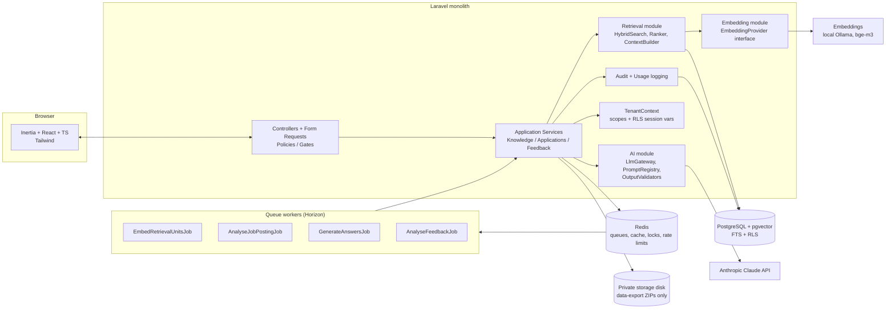
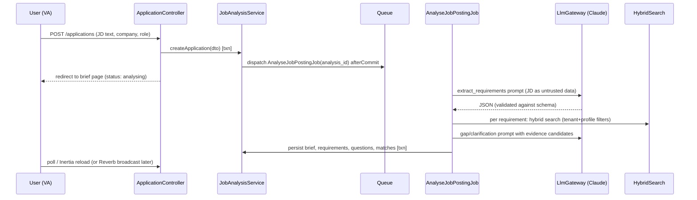
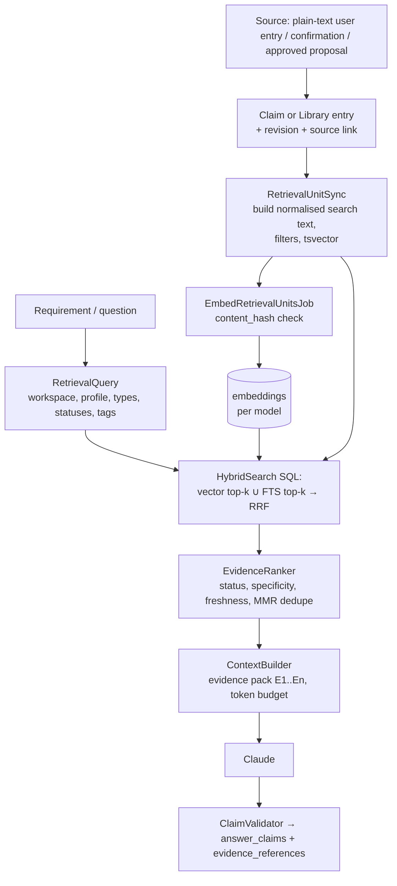
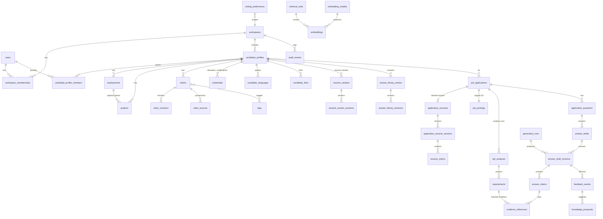

# AI Job Application Knowledge Engine — Engineering Plan

> Status: planning only. No application code yet. Project: `career-engine` (Laravel 13 + Inertia 3 / React 19 / TS starter kit).
> Items marked **[VERIFY]** are version-sensitive and must be checked against official docs before coding.

## Context

The user and their virtual assistants (VAs) prepare many job applications. Generic cover-letter generators produce unsupported, repetitive text and forget everything between applications. The goal is a Laravel + Inertia/React + PostgreSQL/pgvector platform that:

- keeps a **persistent, provenance-tracked career knowledge base**,
- analyses each job description into a structured **application brief**,
- generates answers using **Evidence-First + Creative Enhancement**, with every important claim labelled `verified | inferred | proposed | hypothetical` and linked to evidence,
- **learns from approved edits** without silently corrupting canonical facts,
- supports a **shared VA workspace** with strict tenant isolation,
- can grow into a multi-team SaaS.

---

# Deliverable 1 — Product and scope definition

## 1.1 Goals
1. Cut time from "pasted job description" to "approved, copy-ready answers" to **< 20 minutes** of human time for a typical application (5 questions + cover letter).
2. Every factual statement about the candidate in a final answer is either backed by verified evidence or visibly flagged.
3. Knowledge improves over time through **explicit, approved** updates, with full history.
4. VAs can do most of the preparation work; the candidate approves facts and final output.
5. No cross-workspace data leakage — enforced server-side at query, embedding and retrieval level.

## 1.2 Non-goals (MVP)
- Automatic submission to job portals, browser automation, scraping of job boards.
- Model fine-tuning.
- Billing, self-serve SaaS signup, public marketing site.
- Real-time collaborative (Google-Docs-style) editing — optimistic locking only.
- Mobile apps; email/calendar integrations; ATS integrations.
- Multi-LLM-provider routing (abstraction exists, only Claude implemented).

## 1.3 Personas and permissions (MVP: deliberately simple)

MVP is **personal use**: exactly **1 candidate (you) + up to 3 VAs**, one workspace, one candidate profile. Only two roles:

| Role | Who | Can do |
|---|---|---|
| `candidate` | You (also the admin) | Everything: manage VAs, settings, AI budget, verify facts, approve/reject all proposals, approve final answers, export/delete data |
| `va` | Up to 3 virtual assistants | Create applications, paste/group JDs, run analysis/generation, edit drafts, submit for review, **edit verified facts only as proposals** (never directly), propose new facts/answers/preferences |

Hard rules:
- Only the `candidate` can move a claim to `verified` or approve a knowledge proposal.
- A VA "editing" a verified fact creates a `knowledge_proposal(revise_claim)`; the canonical claim is unchanged until the candidate approves.
- Seat limit enforced server-side: max 3 active `va` memberships (config `app.max_vas = 3`).
- VA accounts are created by the candidate (invite link or direct creation) — no self-signup.

Future-proofing kept cheap: tables still carry `workspace_id` and `candidate_profile_id` so multi-team SaaS later is an additive change, but the MVP UI never exposes workspaces/profiles and there is no profile-level access control, reviewer, or viewer role.

## 1.4 Core workflows
1. **Onboard knowledge**: type or paste career history as plain text into UI forms (employments, projects, credentials, one statement per claim, or bulk-add one claim per line) plus standard question/answer pairs for the answer library → candidate verifies/approves → verified knowledge base, usable (copy-ready answers) before any AI feature exists. No file uploads, no document parsing, no AI extraction (D8).
2. **Resumes (Profile)**: the Profile page lists your resumes (e.g. "Senior Software Engineer — PHP focused / React focused / Next.js focused / Ruby focused"). Inside a resume you set its title and summary, add or include jobs and projects, choose, order and reword bullet points, and (from slice 5) skills, education, certifications, languages and links. Everything you add is stored once in the shared library; facts (employer, official title, dates) are never edited per resume (D9).
3. **New application (fast path)**: paste JD (+ URL, company, role, deadline) → pick a resume variant (copied into the application's **tailored resume**) → analysis job → review brief (requirements, questions, evidence matches, gaps) → answer clarification questions → tailor the resume (manually in M7, AI-generated from M8) → generate answers and a cover letter that tells the story of the tailored resume → edit with evidence panel → resolve flagged claims → approve → copy/export.
4. **Achievement discovery**: AI flags thin records ("API integration, no outcome") → asks targeted questions → candidate confirms/revises/rejects → confirmed items become verified claims.
5. **Feedback learning**: edited answer → diff analysis → classified suggestions (fact correction / reusable answer / writing preference / one-off) → approval queue → versioned knowledge.
6. **JD collections**: as you apply, JDs are grouped into named collections (e.g. "Laravel backend roles", "Agency roles"); a collection can be flagged `use_for_eval` so its JDs + your approved answers become evaluation cases.
7. **VA workflow**: candidate assigns application to VA → VA prepares → submits for review → candidate approves or requests changes → marked submitted externally.

## 1.5 MVP vs later

| MVP (Phase 1) | Phase 2 | Phase 3 (SaaS) |
|---|---|---|
| Auth, 1 candidate + ≤3 VAs, two roles | Reviewer role, multiple candidate profiles | Multiple workspaces, self-serve signup, billing, SSO, Postgres RLS |
| Manual knowledge entry via plain-text UI forms (no file uploads) | Portfolio URL import, LinkedIn export import | Per-tenant encryption keys |
| Resume variants + per-application tailored resume (manual in M7, AI in M8) | PDF/DOCX resume export with templates | |
| Claims with verification + provenance + revisions | Duplicate merge UI with semantic clustering | Data residency options |
| JD analysis → brief | JD import from URL (fetched server-side, sanitised) | Browser extension for copy-fill |
| Evidence-first generation, claim labels, evidence panel | Reranker model, retrieval tuning UI | Graph agent framework if justified (see ADR-4) |
| Achievement suggestions + approval | Interview prep mode | |
| Feedback diff → proposals → approval queue | Writing-style analytics | |
| Assignment, statuses, deadlines, activity | Notifications (email/Slack) | |
| Copy-to-clipboard + plain-text export | Markdown/DOCX/PDF export | |
| Usage/cost tracking, **monthly AI budget ceiling**, audit log, data export/delete | Eval dashboard in-app | |
| JD records grouped into collections as you apply (feeds eval set) | | |

## 1.6 Key risks and assumptions

Risks:
| Risk | Mitigation |
|---|---|
| LLM labels an invented claim as `verified` | Server-side validator: `verified` only allowed if the claim cites a retrieved record whose status is `verified`; otherwise downgraded to `proposed` and flagged |
| Fabricated citations | Citations must reference IDs from the supplied context set; unknown IDs rejected |
| Proposed claims "laundering" into facts via reuse | Generated answers are never indexed as evidence; only human-confirmed claims become `verified` |
| Cross-tenant leakage via vector search | Tenant filter inside the SQL query + RLS defence-in-depth + automated leakage tests |
| Prompt injection in pasted JDs | Untrusted-content wrapping, no action-capable tools, schema validation, human approval for all writes |
| Cost creep | Per-run token logging, per-workspace monthly budget cap, prompt caching **[VERIFY]**, cheaper model for JD requirement extraction/classification |
| Solo-developer scope | Strict milestone ordering, MVP cut list, spikes before commitments |

Confirmed decisions (2026-10-20):
- D1. Personal use: 1 candidate + max 3 VAs; low volume (< 50 applications/month assumed).
- D2. Data residency / GDPR constraints: none beyond normal good practice for MVP; hosting region free choice.
- D3. Standard Anthropic and embedding-provider data retention is acceptable (no zero-retention arrangement needed).
- D4. Monthly AI budget ceiling is required (see 4.4 "Budget guard").
- D5. VAs may edit verified facts **only as proposals**.
- D6. Export format: **plain text** only (plus copy-to-clipboard).
- D7. Evaluation set: you will group real JD records as you apply; these become the real-world eval set alongside synthetic CI fixtures.
- D8. **Plain-text input only**: every input (career knowledge, JDs, questions, answers, preferences) is typed or pasted as plain text in the UI. No PDF/DOCX/file uploads, no text extraction from files, no AI claim extraction from documents.
- D9. **Resume variants, tailored per job — facts once, wording varies**: one candidate has one verified master record (contact, employments, projects, claims, education, certifications, skills, languages, links) and several reusable **resume variants**. Each job application gets a **tailored resume** copied from a variant, with its own versioned title, summary, selection/order and wording, and the cover letter is written from that tailored resume. Employers, official job titles, dates, degrees and issuers are never copied or edited per variant or per job; bullets cite claims (ADR-9). **Authoring is resume-first**: the Profile page lists the resumes (e.g. "PHP focused", "React focused"); jobs, projects and bullet points are added inside a resume and saved once to the shared library, so other resumes can include them. A resume may show its own **display title** for a job (the official title stays in the library) and its own **wording of a bullet** ("Apply everywhere" rewrites the shared claim).
- D10. **Manual applications before AI**: applications are tracked and prepared by hand before the AI milestones (2026-10-20, no API key yet). Each application has two independent tracks: a **stage** (`saved → preparing → applied → interviewing → offer`, or `rejected`/`withdrawn`) for the job search, shown as the dashboard pipeline, and a **review status** (`not_started → in_progress → in_review → changes_requested → approved`) for the preparation work a VA does for the candidate. The tailored resume is an editable copy of a resume variant; questions are answered by hand or from the answer library. AI analysis and generation (M7/M8) later fill the same tables.
- D11. **Embeddings run locally, free**: a local open-source model served by Ollama (`bge-m3`, 1024 dimensions, ~8k-token context) creates the vectors; Postgres + pgvector stores and searches them (no separate vector database). Career data never leaves the machine for embedding. A hosted provider (Voyage, OpenAI) stays possible behind `EmbeddingProvider` for production hosting without Ollama (2026-10-21).
- D12. **Local-first text generation**: every AI task (job-description analysis, answer writing, claim checking) runs on a local Ollama model by default, so the app works without an Anthropic API key and private data stays on the machine. Claude is optional, per task, and only used when `AI_ALLOW_EXTERNAL=true` is set (explicit consent to send career data). A blind comparison workflow on synthetic samples decides which tasks are worth moving to Claude (2026-10-21; ADR-11).

Remaining assumptions:
- A1. Content is English.

## 1.7 Open questions
1. Initial monthly AI budget value — plan default is **US$30/month** (warn at 80%, hard-stop at 100%, candidate can raise it in Settings). Adjust if you have a number in mind.
2. Should VAs see the AI usage/cost page, or only the candidate? (Plan default: candidate only.)

---

# Deliverable 2 — Architecture

## 2.1 System diagram



Single deployable Laravel app; web and worker processes from the same codebase. All input arrives as plain text from UI forms (D8) — there is no file-upload or document-ingestion path. No separate retrieval service, Python backend, vector DB, or agent framework in MVP.

## 2.2 Component responsibilities (module layout)

Use domain folders under `app/` (no package/modules framework needed):

```
app/
  Http/Controllers/…            thin: authorise, validate, call service, return Inertia
  Http/Requests/…               validation
  Policies/…                    per-model authorisation
  Domain/
    Tenancy/                    Workspace, Membership, TenantContext, BelongsToWorkspace trait, RLS middleware
    Knowledge/                  CandidateProfile, Employment, Project, Claim, ClaimRevision, Source,
                                AnswerLibraryEntry, WritingPreference; KnowledgeService, DuplicateDetector
    Retrieval/                  RetrievalUnit, Embedding, EmbeddingModel; RetrievalUnitSync,
                                HybridSearch, EvidenceRanker, ContextBuilder, RetrievalQuery DTO
    Ai/                         LlmClient (interface), AnthropicLlmClient, PromptRegistry, PromptTemplate,
                                GenerationRun, StructuredOutput validators, CostCalculator
    Embeddings/                 EmbeddingProvider (interface), OllamaEmbeddingProvider, FakeEmbeddingProvider
    Applications/               JobApplication, JobPosting, JobAnalysis, Requirement, ApplicationQuestion,
                                AnswerDraft, AnswerVersion, AnswerClaim, EvidenceReference;
                                JobAnalysisService, AnswerGenerationService, ClaimValidator, ExportService
    Feedback/                   FeedbackEvent, KnowledgeProposal; FeedbackAnalysisService, ProposalApplier
    Audit/                      AuditEvent, AuditLogger
  Jobs/                         queue jobs (thin; call services)
  Data/                         DTOs (spatie/laravel-data or plain readonly classes — decide in M1)
resources/js/
  Pages/…  Components/…  types/ (generated from DTOs)
prompts/                        versioned prompt templates (files in git) + JSON schemas
```

Rules: controllers never call the LLM directly; services own transactions; jobs are idempotent wrappers around services; only `Retrieval` builds vector/FTS SQL; only `Ai` talks to Anthropic.

## 2.3 Request and job flows

**JD analysis (async with progress):**


**Generation:** `POST /applications/{id}/generate` → `GenerateAnswersJob(application_id, question_ids, idempotency_key)` → for each question: RetrievalQuery → ContextBuilder (evidence pack with stable IDs `E1..En`) → Claude structured output → ClaimValidator → persist `answer_draft_versions` + `answer_claims` + `evidence_references` in one transaction.

**Feedback:** saving a human edit creates a new `answer_version` (author=user). On "Approve" or explicit "Learn from my edits", dispatch `AnalyseFeedbackJob(feedback_event_id)` → Claude classifies diff → `knowledge_proposals` (status `pending`) → approval queue → `ProposalApplier` writes new revisions in a transaction.

## 2.4 RAG data flow



## 2.5 Key design decisions (summary; full ADRs in Deliverable 6)
- **Monolith** over services: one developer, low volume; module boundaries in code suffice.
- **Hybrid retrieval inside PostgreSQL** (one SQL query, reciprocal rank fusion) — no separate search service until measured need (see ADR-4 triggers).
- **Derived `retrieval_units` table** decouples canonical knowledge (claims, library answers, employment/project summaries) from search representation; can be rebuilt any time.
- **Claims as atomic facts** with append-only revisions — the unit of verification and citation.
- **Human-in-the-loop for every canonical write** originating from AI.
- **Async jobs for every LLM call** (no LLM calls in the web request path), so timeouts/retries are controlled.

---

# Deliverable 3 — Database design

## 3.1 Conventions
- PKs: `bigint` identity internally + `ulid` public id column for URLs (avoids enumeration). **Every tenant table has `workspace_id NOT NULL`** (denormalised on purpose for RLS, indexes and cheap filtering).
- Composite FKs `(workspace_id, x_id)` → `(workspace_id, id)` on key relationships so a row can never reference another workspace's row (requires `UNIQUE (workspace_id, id)` on parents). This is the cheapest strong isolation guarantee Postgres offers.
- Timestamps `timestamptz`. Soft deletes only where restore is a product feature (applications); knowledge uses `status = archived` + revisions instead.
- Optimistic locking: `lock_version int` on mutable heads (claims, answer_drafts, applications, proposals).
- Enums as `text` + `CHECK` constraints (easier migrations than PG enums).

## 3.2 ER diagram (core)



## 3.3 Table definitions (important columns)

### Identity & tenancy
- **users**: id, ulid, name, email (unique, citext), password, two_factor_*, is_active, last_login_at.
- **workspaces**: id, ulid, name, settings jsonb (default models), monthly_ai_budget_micros bigint (default 30_000_000 = US$30), budget_warn_pct smallint (default 80), created_by. MVP: exactly one row, created by a seeder/install command.
- **workspace_memberships**: id, workspace_id, user_id, role (`candidate|va`), created_by. `UNIQUE(workspace_id, user_id)`; partial unique `UNIQUE(workspace_id) WHERE role='candidate'` (exactly one candidate); VA seat limit (≤ 3 active) enforced in `MembershipService` inside a transaction with `FOR UPDATE` on the workspace row.
- **candidate_profiles**: id, ulid, workspace_id, user_id (the candidate's account), display_name, contact info shared by every resume variant (email citext, phone, location). The former `headline` was copied into a default resume's title and dropped (M3 slice 4). `UNIQUE(workspace_id, id)`. MVP: one row — the *person*; resume variants are separate rows (see "Resumes").
- (Dropped for MVP: invitations table — candidate creates VA accounts directly and shares a password-reset link; candidate_profile_members; extra roles.)

### Career knowledge (canonical)
- **employments**: id, workspace_id, candidate_profile_id, employer_name, employer_normalized, title, employment_type, location, start_date, end_date (null=current), date_precision (`day|month|year`), summary, status (`verified|proposed|archived`), lock_version.
- **projects**: id, workspace_id, candidate_profile_id, employment_id (nullable), name, client_name (nullable — careful: confidential), role, start/end, summary, url, status, lock_version.
- **claims** — the atomic, citable unit:
  - id, ulid, workspace_id, candidate_profile_id
  - subject_type (`employment|project|credential|general`), subject_id (nullable)
  - kind (`achievement|responsibility|skill|qualification|other`) — kept short on purpose: a metric is an achievement with a number, a technology is a skill
  - current_revision_id (FK claim_revisions)
  - status (`verified|proposed|rejected|archived`) — **only verified claims can back a `verified` label**; `rejected` = a proposed claim the candidate turned down (restorable)
  - origin (`user_entered|ai_suggested|feedback_derived|imported`)
  - normalized_hash (sha256 of normalised statement — exact-dup guard)
  - verified_by, verified_at, lock_version
  - Constraints: `CHECK (status <> 'verified' OR verified_by IS NOT NULL)`; partial unique `UNIQUE(candidate_profile_id, normalized_hash) WHERE status IN ('verified','proposed')`.
- **claim_revisions** (append-only): id, workspace_id, claim_id, revision_no, statement text, structured jsonb (e.g. `{metric: {value, unit, period}, technologies: []}`), date_from/date_to, change_reason, created_by, created_via (`manual|proposal:{id}|import`), created_at. `UNIQUE(claim_id, revision_no)`.
- **claim_sources** (provenance, many per claim): id, workspace_id, claim_id, claim_revision_id, source_type (`user_confirmation|project|employment|external_url|answer_version`), source_id, quote/excerpt (short span), confirmed_by, created_at. Note: `answer_version` source is allowed only to record *where it was first suggested*; it never satisfies verification on its own (enforced in `KnowledgeService::verify`, which requires a `user_confirmation` source).
- **tags**: id, workspace_id, kind (`skill|technology|domain|industry`), name, normalized_name. `UNIQUE(workspace_id, kind, normalized_name)`.
- **taggables**: tag_id, taggable_type, taggable_id, workspace_id.
- **credentials** (education and certifications): id, ulid, workspace_id, candidate_profile_id, type (`education|certification`), institution (school / issuer), name (degree / certificate), field_of_study, start_date, end_date (awarded), expires_on, credential_url, summary, status (`verified|proposed|archived`), verified_by/at, created_by, lock_version. Same lifecycle as employments/projects; claims can have `subject_type = credential`.
- **candidate_languages**: id, workspace_id, candidate_profile_id, language, proficiency (`native|fluent|professional|conversational|basic`), position.
- **candidate_links**: id, workspace_id, candidate_profile_id, kind (`portfolio|github|linkedin|website|other`), label, url (http/https only), position.
- **Skills**: `tags` (kind `skill|technology|domain`) attached to the candidate profile via `taggables`; claims are tagged the same way.

### No documents tables (D8)
There are no `documents` / `document_chunks` tables: nothing is uploaded or extracted. All knowledge is plain text stored directly on the canonical rows (`claim_revisions.statement`, `employments.summary`, `projects.summary`, library answer bodies). Longer context, such as a case study, goes into a project's `summary` as plain text.

### Reusable content
- **answer_library_entries**: id, workspace_id, candidate_profile_id, question (plain text, trigram-indexed), category (`motivation|strengths|weaknesses|behavioural|technical|salary|availability|other`), current_revision_id, status (`approved|draft|archived`), approved_by/at, lock_version. Merges the prompt's `question_templates` and `approved_answers`. Entries are profile-owned in the MVP; workspace-shared templates are deferred.
- **answer_library_revisions**: answer_library_entry_id, revision_no, body (trigram-indexed), claim_ulids jsonb (claims the answer relies on; validated as live claims of the workspace on save), change_reason, created_by, created_via (`manual|proposal:{id}`). Append-only (DB trigger).
- **writing_preferences**: id, workspace_id, scope (`user|profile|workspace`), user_id / candidate_profile_id (per scope), rule text (e.g. "British spelling", "No 'passionate'"), kind (`tone|banned_phrase|format|spelling|structure`), status, examples jsonb, created_via. CHECK that exactly the right owner column is set for the scope.

### Retrieval (derived, rebuildable)
- **retrieval_units**: id, workspace_id, candidate_profile_id (nullable for workspace-shared), visibility, unit_type (`claim|library_answer|project_summary|employment_summary`), source_type, source_id, source_revision_id, parent_type/parent_id (the job or project a bullet point or project belongs to; used to prefer specific units over their parent summary), status (copied from source: `verified|proposed|approved`), search_text, tsv `tsvector GENERATED ALWAYS AS (to_tsvector('english', search_text)) STORED`, tag_ids int[], employer_normalized, date_to, specificity_score real, content_hash, is_active bool, updated_at. `UNIQUE(source_type, source_id)`.
- **embedding_models**: id, provider, model, dimensions, distance (`cosine`), input_type_doc, input_type_query, is_active_for_write, is_active_for_read, created_at.
- **embeddings**: id, workspace_id, retrieval_unit_id, embedding_model_id, content_hash, embedding `halfvec` (no fixed dimension at column level; `ALTER COLUMN embedding SET STORAGE PLAIN` so values stay inline instead of TOASTed — S3), created_at. `UNIQUE(retrieval_unit_id, embedding_model_id)`.

### Applications
- **jd_collections** (built in M7): id, ulid, workspace_id, name, description, use_for_eval bool (set by the candidate only), created_by. Names are not unique.
- **jd_collection_items**: jd_collection_id, job_application_id, added_by, added_at. PK(collection, application). Many-to-many so one JD can sit in several groups.
- **job_applications**: id, ulid, workspace_id, candidate_profile_id, company_name, role_title, source_url, location, employment_type, salary_text, stage (`saved|preparing|applied|interviewing|offer|rejected|withdrawn`, the job-search pipeline), review_status (`not_started|in_progress|in_review|changes_requested|approved`, the VA preparation workflow; D10), review_note (latest submit / request-changes note), review_status_changed_at, assigned_user_id, analysis_status (M7: `none|analysing|ready|failed`), owner_user_id, deadline_on (date), submitted_at, notes, lock_version, deleted_at.
- **job_postings**: id, workspace_id, job_application_id (unique), raw_text (verbatim, immutable), raw_sha256, captured_at, captured_by.
- **job_analyses** (built in M7): id, ulid, workspace_id, job_application_id, job_posting_id (the exact text analysed), generation_run_id, prompt_version, status (`queued|running|succeeded|failed|invalid_output`), matches jsonb (requirement ↔ evidence matrix, refreshable), matched_at, error_message, requested_by, completed_at; brief jsonb (validated: summary, employer language, seniority, must-haves, nice-to-haves, red flags, injection_warnings), status, created_at. Multiple per application (re-analysis); `job_applications.current_analysis_id`.
- **requirements**: id, workspace_id, job_analysis_id, kind (`must|preferred|responsibility|employer_value`), text, importance smallint, verbatim_quote.
- **application_questions**: id, ulid, workspace_id, job_application_id, origin (`extracted|manual|cover_letter`; at most one cover letter per application), prompt_text, word_limit, char_limit, position, created_by. Answer state lives on the answer draft.
- **clarification_requests** (built in M7): id, ulid, workspace_id, job_application_id, job_analysis_id, requirement, requirement_hash (one open request per requirement and application), question_text, status (`open|answered|dismissed|resolved`), answer_text, converted_claim_id (the bullet point the answer became), answered_by, answered_at.

### Resumes (D9, ADR-9)
Facts live once in the master record; resume variants and tailored resumes only **choose, order and word** them.
- **resume_variants** (M3): id, ulid, workspace_id, candidate_profile_id, name (internal, e.g. "Laravel backend"), is_default (partial unique per profile `WHERE is_default`), status (`active|archived`), current_revision_id, lock_version.
- **resume_variant_revisions** (append-only, M3): id, workspace_id, resume_variant_id, revision_no, document jsonb, created_by, created_via (`manual|duplicated:{id}|from_application:{id}|proposal:{id}`), created_at. `UNIQUE(resume_variant_id, revision_no)`.
- **application_resumes** (M7a slice B): id, ulid, workspace_id, job_application_id (unique), based_on_variant_id, based_on_revision_id, current_version_id, approved_version_id, status (`draft|approved`; review happens on the application, D10), generation_status/error/requested_at/by (AI tailoring, M8), approved_by/at, lock_version.
- **application_resume_versions** (append-only, M7): id, workspace_id, application_resume_id, version_no, document jsonb, facts_snapshot jsonb (employer/title/dates/degree as they were when the version was made, so a submitted resume can be reproduced), author_type (`user|ai`), author_user_id, created_via (`manual|copied:<variant>|ai`), generation_run_id, ai_report jsonb (M8: what the server refused from the AI's proposal and why, plus the AI's notes), parent_version_id, created_at. An approved version is frozen; if the master record changes later, the UI shows "facts changed since this version".
- **resume_claims** (M8): same shape as `answer_claims` (classification, validation flags, resolution), plus `path` into the document (e.g. `experience.0.bullets.2`).

**Resume document** (`schema_version: 1`, validated by `ResumeDocumentValidator` on every save; one format for variants and tailored versions; slice 5 adds `skills`, `education`, `certifications`, `languages`, `links` keys):
`{schema_version, title, summary, experience: [{employment: ulid, display_title, description, bullets: [{claim: ulid, text}], projects: [{project: ulid, description, bullets: [...]}]}], projects: [{project: ulid, description, bullets: [...]}], skills: [{label, items: [skill ulid]}], education: [{credential: ulid}], certifications: [{credential: ulid}], languages: [language ulid], links: [link ulid]}` (sections missing from older revisions read as empty lists)
- Facts (employer, official job title, dates, institution) and contact details are **not** in the document: they are read from the master record by ULID, so they cannot be changed per variant or per job.
- `display_title` (optional): how this resume shows the job title; the official title stays on the employment (and in `facts_snapshot` for tailored versions). Candidate-only; the AI may reuse existing display titles but never invent one.
- Every bullet is backed by a claim: `{claim, text}` where `text = null` uses the claim's current wording and a non-null `text` is a rewording for this resume only.
- On save: every ULID exists in this workspace and is not archived; each job appears once; projects under a job belong to that job, top-level projects are standalone; each bullet's claim is a live claim about that job/project; plain-text normalisation and length limits apply.
- Trade-off (ADR-9): refs inside JSON have no foreign key. An archived or removed item shows as "Removed from your record" in the editor.
- Variants and tailored versions are **never embedded or retrieved as evidence**.

### Answers, versions, claims, evidence
- **answer_drafts** (M7a slice C): id, workspace_id, application_question_id (unique), current_version_id, approved_version_id, status (`draft|approved`), approved_by/at, lock_version; M8 adds generation_status (`queued|running|failed`, null when idle — kept apart from `status` so an approved answer stays approved), generation_error, generation_requested_at/by, generation_instruction (for the pending redraft), claims_reviewed_version_id (the AI version whose unconfirmed claims the candidate checked — the approval gate).
- **answer_draft_versions** (append-only; built in M7a slice C): id, workspace_id, answer_draft_id, version_no, body text, library_entry_id (the answer-library entry the text was inserted from), author_type (`ai|user`), author_user_id, created_via (`manual|library|ai`), created_at; M8 slice 1 adds generation_run_id and jsonb evidence_pack (E1… → status, text, ref), grounding (server-checked claim labels and flags), clarification_questions, instruction (the redraft instruction), resume_version_id (the tailored resume version a cover letter was written from); parent_version_id and `answer_claims` rows come with M9. `UNIQUE(answer_draft_id, version_no)`.
- **answer_claims**: id, workspace_id, answer_version_id, span_start, span_end, text, classification (`verified|inferred|proposed|hypothetical`), model_classification (what the LLM said, for eval), validation_flags text[] (e.g. `downgraded_no_verified_evidence`, `metric_without_source`), resolution (`open|accepted|removed|converted_to_proposal`), resolved_by.
- **evidence_references**: id, workspace_id, referrer_type (`answer_claim|resume_claim|requirement`), referrer_id, retrieval_unit_id, source_type, source_id, source_revision_id (pin the exact revision cited), relevance_score, rank.

### Feedback & proposals
- **feedback_events**: id, workspace_id, answer_draft_id, from_version_id, to_version_id, user_id, diff jsonb (computed server-side), analysis jsonb (Claude output), generation_run_id, status (`pending_analysis|analysed|failed`).
- **knowledge_proposals**: id, ulid, workspace_id, candidate_profile_id, origin (`feedback|achievement_suggestion|clarification|manual`), origin_id, proposal_type (built in M3 slices 6–7: `revise_claim|revise_record|revise_library_answer`; later: `create_claim|archive_claim|create_library_answer|create_writing_preference|one_off_no_action`), target_type (`claim|employment|project|credential|answer_library_entry`), target_id, base_version (claim: current revision id; other records: lock_version — for conflict detection), payload jsonb (the new values, as validated by the item's form request), rationale, status (`pending|approved|rejected|superseded|conflict`), proposed_by_user_id / proposed_by_run_id, decided_by, decided_at, decision_note, lock_version.
  - Partial unique: `UNIQUE(target_type, target_id, proposal_type) WHERE status='pending'` for revise types — prevents conflicting concurrent pending edits; new ones mark older as `superseded`.

### Operations
- **generation_runs**: id, ulid, workspace_id, purpose (`jd_analysis|answer_generation|feedback_analysis|achievement_suggestion|grounding_check`), prompt_key, prompt_version, model, request_hash, idempotency_key (unique), input_tokens, output_tokens, cache_read_tokens, cache_write_tokens, cost_micros, latency_ms, status (`queued|running|succeeded|failed|invalid_output`), error_code, attempt, created_by. Store prompt/response bodies **only** in an encrypted, TTL'd `generation_payloads` table (debug, default 14-day retention) — not in logs.
- **audit_events**: id, workspace_id, actor_user_id, actor_type (`user|system|job`), action (`claim.verified`, `proposal.approved`, `data_export.downloaded`, `member.role_changed`, …), subject_type, subject_id, metadata jsonb (no content bodies), ip_hash, created_at. Append-only (revoke UPDATE/DELETE from app role). Doubles as activity history.

## 3.4 How the schema supports the requirements
- **Provenance**: `claim_sources` (+ pinned `claim_revision_id`), `evidence_references.source_revision_id`, `knowledge_proposals.origin`.
- **Verification status**: `claims.status` + `verified_by/at` CHECK; `answer_claims.classification` + validator flags.
- **Versioning**: append-only `*_revisions`/`answer_draft_versions`; heads carry `current_revision_id` + `lock_version`.
- **Private vs shared**: `candidate_profile_id` (private to profile) vs `NULL` + `visibility='workspace'` (shared templates); `writing_preferences.scope` for user-level.
- **Embedding model/dimension changes**: `embedding_models` + per-model rows in `embeddings`; untyped `halfvec` column with per-model partial expression HNSW indexes when needed (`(embedding::halfvec(1024))` with `WHERE embedding_model_id = N`; the same pattern on `vector` was verified to work in S3; HNSW dimension limit for `halfvec` is 4,000 **[VERIFY]** against the pgvector README before adding the index).
- **Efficient hybrid retrieval**: one table (`retrieval_units`) with GIN on `tsv`, btree on `(workspace_id, candidate_profile_id, unit_type, status)`, GIN on `tag_ids`, HNSW per model on `embeddings`.
- **Concurrent edit/approval**: `lock_version` checks (409 on mismatch with merge UI), `SELECT … FOR UPDATE` on proposal + target in `ProposalApplier`, base-revision conflict detection.
- **Tenant isolation**: `workspace_id` everywhere, global scope, policies; RLS later (3.6).

## 3.5 Indexes & pgvector strategy
- `retrieval_units`: `GIN(tsv)`; `BTREE(workspace_id, candidate_profile_id, is_active, unit_type, status)`; `GIN(tag_ids)`.
- `embeddings`: `BTREE(workspace_id, embedding_model_id)` from the start. HNSW `((embedding::halfvec(D)) halfvec_cosine_ops) WHERE embedding_model_id = N` per active model **only once needed** (see below).
- **Measured in S3 (`docs/spikes/S3.md`)**: exact scan within the tenant/profile filter takes ≤ 15 ms for ~7k matching rows with `halfvec`, so the **MVP ships without a vector index**. Add HNSW when a profile exceeds ~10k active units or retrieval p95 > 150 ms. Once an HNSW index exists, HybridSearch must run `SET LOCAL hnsw.iterative_scan = relaxed_order` in its transaction: without it, filtered HNSW silently returns too few rows (14 of 40 in S3), and with it recall is ~0.96.
- Other: `job_applications(workspace_id, stage, deadline_on)`, `(workspace_id, assigned_user_id, review_status)`; `knowledge_proposals(workspace_id, status, created_at)`; `audit_events(workspace_id, created_at desc)`; `claims(candidate_profile_id, status, kind)`; trigram index on `claims` statement (via `claim_revisions`) for near-duplicate detection (`pg_trgm`).

## 3.6 Access control & tenant isolation (MVP: simple, future-proof)
With one workspace and one candidate, the real MVP boundary is **role** (candidate vs VA) and **authentication** (nobody else sees anything). Plan:
1. **Laravel authorisation** (MVP, primary): policies + gates for every action (`verify-claim`, `approve-proposal`, `manage-vas`, `manage-budget` → candidate only). All routes behind `auth` + 2FA for the candidate.
2. **Tenant scoping kept in code from day one, cheaply**: every tenant table has `workspace_id`; a `BelongsToWorkspace` trait sets it on create and a global scope filters by the current workspace (resolved from the user's single membership — no `/w/{workspace}` URLs in MVP). Retrieval SQL always filters by `workspace_id` + `candidate_profile_id`. Composite FKs where cheap.
3. **PostgreSQL RLS: deferred to Phase 3** (multi-team SaaS). With a single tenant it adds friction without protecting against a realistic MVP threat. The `workspace_id` columns + scope make adding RLS later a migration + middleware, not a redesign. A small test suite with a second seeded workspace still runs in CI so the scoping code stays correct.

## 3.7 Data lifecycle & migrations
- Migrations via Laravel; raw SQL statements for pgvector/RLS/partial indexes (`DB::statement`). `CREATE EXTENSION vector, pg_trgm, citext` in the first migration (requires managed-PG support **[VERIFY]**).
- Backups: managed PG daily snapshots + PITR (≥ 7 days); export ZIPs auto-deleted after 24h; quarterly restore drill (documented runbook).
- Retention: `generation_payloads` 14 days; `audit_events` 2 years; deleted applications purged after 30 days.
- **Answer export (MVP)**: plain text only — per answer copy button, and "Export application" producing a `.txt` (question headings + final approved answers + cover letter). No Markdown/DOCX/PDF in MVP.
- **Data export (backup/portability)**: candidate-only ZIP (JSON of all knowledge + revisions + applications) via queued job, signed URL, expires in 24h.
- **Deletion**: profile/workspace deletion job — hard deletes rows (cascade), export files, embeddings, generation payloads; writes a tombstone audit event without content. Note Anthropic/Voyage-side retention is governed by their policies **[VERIFY]**.
- Re-embedding: new `embedding_models` row → backfill job → flip `is_active_for_read` → drop old vectors after a grace period.

---

# Deliverable 4 — AI and RAG design

## 4.1 Knowledge entry (plain text only — D8)
No file uploads, no PDF/DOCX parsing, no chunking and no AI claim extraction. Knowledge enters the system only through UI forms.
1. **Structured forms**: employments, projects, credentials, writing preferences and library answers are created through Inertia forms with plain-text fields (`<textarea>` / `<input>`, no rich text).
2. **Answer library**: question + answer pairs entered by hand (or several pasted at once, separated by a `---` line), with category and optional linked claims. Candidate entries are `approved`, VA entries stay `draft` until the candidate approves them. They are indexed as `library_answer` retrieval units from M6 on.
3. **Claims**: one statement per claim, attached to an employment/project/credential or `general`. **Bulk add**: paste a list into a textarea and each non-empty line becomes a draft claim under the chosen subject. This is a deterministic split with no AI, previewed before saving.
4. **Server-side normalisation** (Form Requests): trim, Unicode NFC, collapse whitespace, strip control and zero-width characters, length limits (claim ≤ 1,000 chars, summaries ≤ 5,000, JD ≤ 50,000).
5. **Status on save**: claims the candidate enters can be saved as `verified` directly, with `claim_sources(user_confirmation)`. Claims a VA enters are saved as `proposed`, and a VA's change to a verified claim becomes a `revise_claim` proposal (D5).
6. **Duplicate detection** before insert: exact `normalized_hash`; near-dup via `pg_trgm similarity > 0.6` within same subject, then embedding cosine > 0.92 **[tune in eval]** → surfaced as "possible duplicate of …: merge / keep both".

## 4.2 What to embed
| Embed | Why |
|---|---|
| Claims (verified + proposed, current revision; text includes subject context: "At Acme (2021–23), Senior Dev: …") | Primary evidence |
| Approved library answers (question_pattern + body) | Reuse and style |
| Employment/project summaries | Broad context matching; fallback evidence for context not yet split into claims |
| **Do not embed**: generated answer versions and resume variants / tailored resume versions (prevents laundering — wording is not evidence), audit/ops data, job postings (they're queries, embed transiently or cache per analysis), writing preferences (always included by rule, not retrieved), rejected/archived items |

Embedding versioning: `content_hash = sha256(model_id + search_text)`; `EmbedRetrievalUnitsJob` skips when hash unchanged. Regenerate when: source revision changes, `search_text` template version changes (bump `RETRIEVAL_TEXT_VERSION`), or model changes (backfill).

**Embedding provider (D11, ADR-10)**: a local **Ollama** server with **`bge-m3`** (1024 dimensions, dense vectors, cosine) via its HTTP API (`POST /api/embed`); no API key, no per-token cost, data stays local. `bge-m3` needs no query/document prefixes. Hosted alternatives behind the same interface: Voyage AI (Anthropic-recommended), OpenAI `text-embedding-3-small`. `EmbeddingProvider` interface: `embedDocuments(array $texts): EmbeddingBatch`, `embedQuery(string): Vector`, `model(): EmbeddingModelSpec`. `FakeEmbeddingProvider` (deterministic hash vectors) for tests.

## 4.3 Hybrid retrieval and ranking
**Query construction** per requirement/question: text = requirement + question + key employer terms; filters from `RetrievalQuery` DTO: `workspace_id` (mandatory), `candidate_profile_id` (mandatory unless shared-only), `allowed_visibility`, `unit_types`, `statuses` (default `verified, proposed, approved`), optional tag/employer/date filters.

**SQL (single round trip, CTEs):**
1. `semantic`: top 40 by cosine distance from `embeddings` joined to filtered `retrieval_units`.
2. `lexical`: top 40 by `ts_rank_cd(tsv, websearch_to_tsquery('english', :q))`, with the query terms joined by `or` (AND semantics match almost nothing for multi-term requirements).
3. `fused`: Reciprocal Rank Fusion `Σ 1/(60 + rank)`; return top 30 with both ranks.

**App-side reranking (`EvidenceRanker`)**: `final = rrf_norm * w1 + status_boost (verified 1.0, approved 0.9, proposed 0.4) * w2 + specificity (has metric/named tech/date) * w3 + freshness decay (half-life ~5y on date_to) * w4`. Weights in config, tuned by eval. Then **MMR**-style dedupe: drop items with cosine > 0.9 to an already-selected item or same `source_id` lineage (a claim vs. its parent employment/project summary — prefer the claim). Cap: ~8 items per requirement, ~25 per generation, token budget ~6k for evidence.

Optional later: Voyage rerank model **[VERIFY]** or Claude-based rerank — only if eval shows precision gap.

**Access control before LLM**: filters are in the SQL; `ContextBuilder` asserts every item's `workspace_id`/`candidate_profile_id` matches the run's context (throws + audit on mismatch). RLS backs it up.

**Postgres vs separate service**: implement **directly in PostgreSQL**. Revisit when: >1M units, p95 retrieval > 300 ms after tuning, need for learned sparse retrieval / cross-language, or multi-region. Even then, first step is a read replica, not a new datastore.

## 4.4 Claude prompt architecture
- **Prompt registry**: prompts as files in `prompts/{key}/v{n}.md` + `schema.json`; `PromptRegistry::get('answer_generation', version)`; version + model recorded on every `generation_run`. Changing a prompt = new version file (immutable once used in prod).
- **Budget guard (monthly ceiling)**: `workspaces.monthly_ai_budget_micros` (default US$30, editable by candidate in Settings). Before every LLM/embedding call, `BudgetGuard` sums `generation_runs.cost_micros` for the current calendar month (UTC) + an *estimated* cost of the pending call (input tokens counted/estimated × price, max_tokens × output price). ≥ 80% → warning banner + one email/notice to the candidate; ≥ 100% → new runs refused with a clear UI message (candidate can raise the ceiling). Check-and-reserve is atomic (Redis lock or `FOR UPDATE` on the workspace row) so concurrent jobs can't overshoot by more than one call. Embedding costs are included. Price table in `config/ai.php` **[VERIFY current prices]**.
- **Model config** (`config/ai.php`, overridable per workspace): e.g. generation/feedback analysis → `claude-sonnet-5-5`; JD requirement extraction/classification/grounding check → `claude-haiku-5-5`. **[VERIFY]** current model IDs, pricing, context limits via the claude-api reference before M4.
- **Structured outputs**: use Claude tool-use with a JSON-schema'd tool (or native structured-output feature if available **[VERIFY]**) and force the tool choice; then **always** validate server-side with a JSON schema validator (`opis/json-schema`) + typed DTO hydration. Invalid → one repair retry with validation errors → else `invalid_output` failure surfaced to user.
- **Message layout** (cache-friendly ordering **[VERIFY prompt-caching semantics]**):
  1. System: role, Evidence-First + Creative Enhancement policy, claim taxonomy, untrusted-content policy, output contract.
  2. Writing preferences (stable per workspace → cacheable).
  3. Application brief + evidence pack: `<evidence id="E3" type="claim" status="verified" source="claim:01H…">…</evidence>`.
  4. Untrusted JD excerpt inside `<job_description untrusted="true">…</job_description>`.
  5. Task: specific question, word/char limit, tone.
- **Generation output schema (per question)**:
  ```json
  {
    "answer": "string",
    "segments": [{"text": "...", "claims": [{"text": "...", "classification": "verified|inferred|proposed|hypothetical", "evidence_ids": ["E3"], "rationale": "..."}]}],
    "clarification_questions": [{"question": "...", "why": "...", "blocking": true}],
    "achievement_suggestions": [{"related_evidence_id": "E5", "prompt_to_user": "Did the integration reduce manual processing time? Roughly how much?", "candidate_metric": "hours saved per week"}],
    "self_check": {"unsupported_claims_present": false, "word_count": 230}
  }
  ```
- **Policy text (key rules)**: retrieve-then-write; prefer verified/approved; may construct answers and approaches (label `hypothetical`), may reframe/transfer skills (`inferred`, must cite the verified basis), may suggest achievements (`proposed`, phrased as questions or placeholders like `[confirm: % reduction]` never as fact); never invent numbers, clients, employers, titles, dates, qualifications; banned-phrase list from writing preferences + a default list ("passionate", "fast-paced environment", "I am writing to express", "leverage synergies"…); tailor to employer language from the brief.

## 4.5 Claim classification & evidence tracking (server-side `ClaimValidator`)
For each claim from the model:
1. All `evidence_ids` must exist in the supplied pack → else strip IDs + flag `fabricated_citation`.
2. `verified` requires ≥1 cited item with status `verified`/`approved` → else downgrade to `proposed` + flag.
3. `inferred` requires ≥1 cited verified item → else downgrade to `proposed`.
4. Regex/heuristic detectors on answer text: numbers/percentages/currency, years, ALL-CAPS acronyms (certs), organisation names not present in evidence → any such token not found in cited evidence text → flag `unsupported_specific` (catches claims the model didn't declare).
5. Locate claim spans in `answer` (exact/fuzzy match) for highlighting; unlocatable → flag.
6. Optional **grounding check** pass (Haiku): "Does E3 support statement X? yes/partial/no" for verified/inferred claims — enabled when eval shows value.
7. Approval gate: an answer cannot be approved while it has `open` claims classified `proposed` or flagged — user must accept (keep as hedged wording), edit, remove, or "convert to proposal" (creates a `knowledge_proposal` for the candidate). Hypothetical claims are allowed but shown with a label.

## 4.6 Achievement suggestions
- Triggered (a) during generation (schema field above), (b) by a scheduled "knowledge health" job over claims of kind `responsibility` with no linked `achievement/metric` (Haiku, batched, budget-capped).
- Stored as `knowledge_proposals(origin=achievement_suggestion, proposal_type=create_claim, payload={draft_statement_with_placeholders, questions[]})`, status `pending`.
- UI: candidate answers the question (e.g. "about 6 hours/week"), edits the draft statement, confirms → claim `verified` with `claim_sources(user_confirmation)`; reject → stored rejection (prevents re-suggesting via `rejected_suggestion_hash`).

## 4.7 Feedback and approval pipeline
1. Human edit saved → new `answer_version(author=user)`.
2. On approval of the answer (or explicit "learn from edits"), `feedback_events` row with server-computed diff (word-level, `jfcherng/php-diff` or similar **[VERIFY]**).
3. `AnalyseFeedbackJob`: Claude receives original, edited, the evidence pack used, current writing preferences → outputs candidate proposals each with `type` (`factual_correction|reusable_answer|writing_preference|one_off`), target (claim ID from pack, or new), payload, confidence, rationale.
4. Validation: targets must be in pack; `one_off` → recorded, no proposal; low-confidence preference changes require ≥2 similar edits before proposing (dedupe by normalised rule).
5. Routing: factual corrections, reusable answers and shared writing preferences → candidate approval queue; a user's *personal* writing preference (scope `user`) → that user may self-approve. VA direct edits of verified facts in the knowledge manager also land here as `revise_claim` proposals.
6. `ProposalApplier` (transaction, `FOR UPDATE` on proposal + target, check `target_revision_id == current_revision_id` else status `conflict` → show 3-way view) writes a new revision, `claim_sources`, audit event, and triggers `RetrievalUnitSync`.

## 4.8 Prompt-injection handling
- Pasted JDs (and any other pasted third-party text) are wrapped and declared untrusted; system prompt says instructions inside are data.
- The model has **no tools that act** (only the output-schema tool); it cannot write to DB, send messages, or fetch URLs.
- Outputs are schema-validated; free text never executed or rendered as HTML (React escapes; Markdown rendering with sanitiser).
- Brief includes `injection_warnings` (model + heuristic scan for "ignore previous", "system prompt", hidden-text/zero-width chars) → banner in UI.
- Extracted "application questions" are shown for human confirmation before generation.
- All knowledge writes require human approval, so injected "add fact X" can at most create a pending proposal.

## 4.9 Evaluation methodology
**Dataset (in repo, `tests/Eval/fixtures`)** — fictional candidate "Alex Morgan" (never real data):
- ~60 claims across 4 employments, 6 projects (mix: verified, proposed, archived; some with metrics, some without), 3 approved library answers, 5 writing preferences (all plain text, as entered through the UI).
- 10 JDs: backend Laravel role, full-stack React, data engineering (partial fit), DevOps (weak fit), product manager (transferable), agency developer, fintech (compliance terms), a JD with 6 explicit questions, a JD with embedded prompt injection, a JD with hidden/zero-width text.
- Labels: per requirement, the set of relevant claim IDs (graded 0–2); per JD, "must-not-claim" list (e.g. Kubernetes, which Alex never used).
- A second tenant fixture "Sam Lee" with overlapping skills to test scoping.
- **Real-world set (D7)**: JD collections flagged `use_for_eval`. `php artisan eval:snapshot {collection}` exports those JDs, the brief, and your approved final answers (with the claim IDs they cited) into a private, git-ignored `storage/eval/real/` set. Approved citations become relevance labels; your edits vs. the first AI draft give an "edit distance" quality signal. Never committed to the repo (real personal data).

**Harness**: `php artisan eval:retrieval` (deterministic, runs in CI with recorded real embeddings committed as fixtures) and `php artisan eval:generation --live` (manual/nightly, real Claude, reports cost).

**Acceptance criteria (initial targets — recalibrate after first baseline):**
| Area | Metric | Target |
|---|---|---|
| Retrieval | Recall@8 of grade-2 evidence per requirement | ≥ 0.85 |
| Retrieval | nDCG@8 | ≥ 0.75 |
| Scoping | Items from another workspace/profile fixture in any context pack | **0** (hard fail) |
| Citations | Cited IDs that exist in pack | 100% (enforced) |
| Citations | Cited evidence judged supportive (human/LLM-judge sample) | ≥ 95% |
| Grounding | Final approved answers containing a `verified`-labelled claim without verified support | 0 (enforced by validator) |
| Grounding | Unsupported specifics (numbers/orgs) not flagged, per 100 answers | ≤ 2 |
| Must-not-claim | Generated drafts asserting a must-not-claim item as fact | 0 in eval set |
| Injection | Injection JDs causing policy deviation (e.g. obeying embedded instructions) | 0/2 + warning shown |
| Reliability | Generation job success incl. retries | ≥ 99% |
| Latency | JD analysis p95 | ≤ 60 s; per-answer generation p95 ≤ 45 s |
| Cost | Full application (analysis + 5 answers + cover letter) | ≤ US$0.60 **[recalibrate with real pricing]** (≈ 50 applications within a US$30 ceiling) |
| Budget | Monthly spend overshoot beyond ceiling | ≤ cost of one call |
| Usability | Paste-to-approved for a 5-question application (moderated test with a VA) | ≤ 20 min, no help needed for core flow |

LLMs cannot guarantee zero hallucinations; the guarantees above are about **labelling and gating** (enforced by code), while the rates are statistical targets.

## 4.10 Tailored resumes and the cover-letter storyline (D9)
- **Inputs**: the application brief (requirements, employer language), the base resume variant revision the application was created from, and the evidence pack (claims with stable IDs `E1..En`).
- **Output** (M8, `prompts/resume_tailoring/v1`): a full resume document in the same JSON schema as variants (`docs/03-database-design.md` → Resumes): title, summary, which experiences/projects/credentials/skills to include and in what order, item summaries and bullet wording. Each bullet lists the evidence IDs it relies on; the server maps them to claim refs.
- **Facts cannot be generated**: the schema has no fields for employer, official job title, dates or institution, so the model can only select and word, never alter facts. For `display_title` the model may only choose a title already used in one of the candidate's resumes (or the official one); bullet rewordings are wording, not evidence, and are validated against the cited claim. Refs the model returns must exist in the base variant's master record set; unknown refs are dropped and flagged.
- **Validation**: `ClaimValidator` runs over every bullet and the summary exactly as for answers (4.5): fabricated evidence IDs stripped, `verified` needs a verified claim, unsupported specifics (numbers, organisations, certifications) flagged. Results land in `resume_claims`; the approval gate blocks approving a tailored version with open flagged or unbacked bullets.
- **Stored as a new version** (`application_resume_versions.author_type = ai`), never overwriting the user's version; the user edits, compares with the variant, and approves.
- **Cover letter**: generated after the tailored resume. It uses the approved (or current) tailored version as the storyline: the chosen experiences in their order, the bullets as proof points with their evidence IDs. The cover letter's `answer_version` records which resume version it was written from.
- **Learning** (M10): edits to a tailored version can become proposals: "apply this summary to the variant", "save this bullet as a new claim" (proposed for VAs, verified when the candidate confirms).

---

# Deliverable 5 — Implementation roadmap

Ordering principle: security & data integrity foundations first, then knowledge, then AI plumbing, then the fast path, then learning loops.

### M0 — Technical spikes (3–5 days)
- **Objective**: de-risk version-sensitive choices before committing.
- **Scope**: S1 Claude structured output from PHP (official Anthropic PHP SDK vs Laravel HTTP client; forced tool / structured outputs; prompt caching; token usage fields). S2 Voyage (or alt) embeddings: model, dims, batching, rate limits. S3 pgvector hybrid SQL on 20k synthetic units: exact vs HNSW with filters, latency. S6 hosting: managed Postgres with pgvector version ≥ 0.8 **[VERIFY]**. (S4 RLS spike moved to Phase 3; S5 PDF/DOCX extraction dropped under D8.)
- **Dependencies**: API keys.
- **Files**: `spikes/` throwaway scripts + `docs/spikes/S*.md` findings.
- **Tests**: N/A (measurements recorded).
- **DoD**: each spike has a written decision; ADRs updated.
- **Risks**: SDK immaturity → fall back to HTTP client behind `LlmClient`.
- **Status (2026-10-21)**: S3 done — `docs/spikes/S3.md` (exact scan for MVP, `halfvec` + `STORAGE PLAIN`, HNSW + `iterative_scan = relaxed_order` later). S2 decided: local Ollama + `bge-m3` (D11, ADR-10); its measurements (speed, halfvec precision on real vectors) run in M6 once Ollama is installed. S1, S6 open.

### M1 — Project foundation & auth (3–4 days)
- **Objective**: deployable skeleton with CI.
- **Already done**: `career-engine` created with Laravel 13, Inertia 3 + React 19 + TS, Tailwind 4, Fortify (auth + 2FA), Wayfinder, Pest 5, Laravel Boost, PHPStan, Pint.
- **Done (2026-10-20)**: PostgreSQL 18 + pgvector 0.8.7 locally (native Windows); first migration `0000_00_00_000000_enable_postgres_extensions` (`vector`, `pg_trgm`, `citext`); PHP tests run on Postgres (`career_engine_test`) instead of SQLite; CI starts a `pgvector/pgvector:pg18` service; Vitest via vite-plus (`npm run test`, wired into `composer ci:check`); lint/format already covered by `vp check` (Oxlint/Oxfmt); PHPStan run with `--memory-limit=1G`.
- **Scope (remaining)**: Redis + Horizon (moved to the staging setup — Horizon needs `pcntl`/`posix`, unavailable on Windows; local dev uses the database queue); React Testing Library + jsdom (add with the first component tests; adding npm packages currently needs `--legacy-peer-deps` because of the vite-plus `vite` alias); Sentry; staging deploy.
- **Files**: `composer.json`, `phpunit.xml`, `vite.config.ts`, `.github/workflows/tests.yml`, `database/migrations/0000_00_00_000000_enable_postgres_extensions.php`.
- **Tests**: auth feature tests, CI green, smoke test page.
- **DoD**: login/2FA on staging; CI runs PHP + JS tests + static analysis.
- **Risks**: starter-kit churn between Laravel versions.

### M2 — Users, roles, audit (2–3 days)
- **Objective**: candidate + up to 3 VAs with enforced permissions.
- **Scope**: `php artisan app:install` (creates the single workspace, candidate account, candidate profile); memberships with `candidate|va`; candidate-only "Team" page to create/deactivate VAs (seat limit 3) and send password-reset link; `BelongsToWorkspace` trait + global scope; job middleware restoring workspace context; gates/policies; `AuditLogger`; 2FA required for candidate.
- **Files**: `app/Domain/Tenancy/*`, `app/Policies/*`, `app/Console/Commands/InstallCommand.php`, `app/Jobs/Middleware/WithWorkspaceContext.php`, `resources/js/Pages/Team/*`.
- **Tests**: role matrix (VA cannot verify/approve/manage VAs/change budget); 4th VA rejected; deactivated VA cannot log in; second seeded workspace's rows never returned (scoping suite, extended by later milestones).
- **DoD**: candidate can add 3 VAs; permission matrix green in CI.
- **Risks**: minimal.
- **Done (2026-10-20)** — implementation notes:
  - Models live in `app/Domain/{Tenancy,Knowledge,Audit}` (factories via `#[UseFactory]`); `User` stays in `app/Models`.
  - `WorkspaceScope` fails closed: querying a tenant model with no workspace in context throws. `SetTenantContext` runs before route-model binding.
  - Fortify self-registration is turned off (no `/register`); deactivated users cannot sign in, and open sessions are ended on the next request (covers passkey logins).
  - VA accounts get a random unusable password; the candidate is shown a one-time **set-password link to share** (no email needed; link lifetime = `auth.passwords.users.expire`, default 60 min, regenerate from the Team page). VA emails count as verified because the candidate vouches for them.
  - `audit_events` is protected by a trigger that rejects UPDATE; DELETE stays possible so workspace deletion (M12) can cascade.
  - The candidate cannot delete their own account from settings (that is the full data deletion in M12).
  - Seat-limit concurrency is guarded by `FOR UPDATE` on the workspace row; no automated concurrency test.
  - The DB session timezone is pinned to UTC (`config/database.php`).

### M3 — Career knowledge manager + resume variants (11–15 days)
- **Objective**: manual knowledge base with verification, revisions and provenance, plus reusable resume variants built from it (D9) — usable on its own before any AI exists.
- **Slices** (in order; claims come before variants because resume bullets cite claims):
  1. Plain-text normalisation + edit candidate profile — **done**
  2. Employments + projects — **done**
  3. Claims: revisions, sources, verify/reject/archive/restore, exact + trigram duplicates, bulk add — **done** (revisions and sources are append-only via a DB trigger; near duplicates warn with "save anyway"; bulk add strips list markers and skips exact duplicates)
  4. **done** — **Resumes core (resume-first UI)**: contact fields; `resume_variants` + revisions; `ResumeDocumentValidator`; **Profile** page (contact + list of resumes); resume editor (include/order jobs and projects, per-resume display title and description, choose/order/reword bullets, "Apply everywhere", add job/project/bullet/paste a list through dialogs that write to the shared library), live preview, plain-text copy, history; `headline` → default resume; UI renames (Job, Bullet point, Short description, Paste a list, Library)
  5. **done** — Skills, education, certifications (`credentials`), languages, links — in the library and as resume sections (skills are candidate-only and grouped per resume, e.g. "Backend: PHP, Laravel"; education/certifications follow the experience rules, VA additions proposed; languages and links live on the contact page; resume documents gain `skills`, `education`, `certifications`, `languages`, `links`, older revisions read them as empty)
  6. **done** — VA edits of verified items as proposals + candidate approve/reject: covers bullet points (`revise_claim`) and experiences, projects, education/certifications (`revise_record`); "Suggest change" in the Library, a "Suggested changes" page with old → new per field, approve (applied through the normal services, counts as the candidate's confirmation) or reject with a note; a newer suggestion supersedes the pending one; a suggestion whose item changed since is marked `conflict` instead of overwriting
  7. **done** — Manual answer library: an **Answers** page (search question and answer text, filter by category, copy button, archived view); add/edit with optional "backed by bullet points" evidence; candidate saves are `approved`, VA saves are `draft` until approved; a VA's edit of an approved answer becomes a suggestion (`revise_library_answer`); every text change appends a revision; "Paste a list" of Q&A pairs separated by `---` with a live preview (max 50)
  8. **done** — Polish: Library filter bar (text across jobs, projects, bullet points, credentials and skills; "Needs verification"; "Not on any resume"); "used in" on every item, including bullet points ("Used in: PHP focused · backs 2 answers") and skills (removing a skill a resume uses asks first); read-only version history on the bullet point and answer edit pages (author, reason, "Approved suggestion")
- **Scope**: contact info; employments, projects, credentials (education, certifications), languages, links, claims + revisions + sources, tags, writing preferences; **manual answer library** (question + your answer as plain text, category, optional linked claims; candidate saves as `approved`, VA saves as `draft` pending candidate approval; revisions; bulk paste of several Q&A pairs separated by a `---` line, previewed before saving, no AI; search/filter by category and text; copy button); **resume variants** (several per candidate, e.g. "Laravel backend"; each with title, summary, chosen and ordered items, item summaries, bullets citing claims; facts read-only from the master record; candidate-only edits; append-only revisions; default variant; duplicate; plain-text copy); all entered as plain text in UI forms (D8); bulk-add claims (paste a list, one claim per line, preview, then save, with no AI); server-side text normalisation + length limits; verify/archive actions; optimistic locking; exact + trigram duplicate detection; knowledge manager UI (list by employment, filters by status/kind/tag, revision history drawer).
- **Files**: `app/Domain/Knowledge/*`, `app/Http/Controllers/Knowledge/*`, `app/Http/Requests/Knowledge/*`, `resources/js/Pages/Knowledge/*`.
- **Tests**: verify requires candidate + confirmation source; bulk add splits lines and skips blanks/duplicates; library entry by candidate is `approved`, by VA is `draft` and only the candidate can approve it; editing an entry appends a revision; Q&A bulk paste splits on `---` and rejects a pair without a question or an answer; normalisation strips control/zero-width chars and enforces limits; revisions append-only; lock_version conflict → 409; duplicate guard; VA edit of a verified claim creates a pending `revise_claim` proposal and leaves the claim unchanged (minimal proposal table + candidate approve/reject lands here; the AI-driven feedback queue arrives in M10); resume document refs must belong to the workspace and not be archived; a document that tries to set employer/title/dates is rejected; a bullet citing another item's claim is rejected; each variant save appends a revision; VA cannot edit variants; one default variant per profile; `headline` → default variant migration.
- **DoD**: you can enter your real career data and your standard Q&A answers, build two resume variants from it, copy them out as plain text, and see full history.
- **Risks**: over-modelling — keep claim `kind` list small.

### M4 — AI gateway & usage tracking (4–5 days)
- **Objective**: one safe path to text-generation models (local Ollama by default, Claude optional — D12, ADR-11).
- **Status (2026-10-21)**: built and tested without Ollama or Claude: `LlmClient` + `OllamaLlmClient` / `ClaudeLlmClient` / `FakeLlmClient`, `LlmRouter` (per-task provider and model, external-data guard), `PromptRegistry` (`prompts/{jd_analysis,answer_writing,claim_check}/v1`), `JsonSchemaValidator` + one repair retry, `ClaimGroundingValidator`, `AiGateway` (budget reservation per workspace, idempotency keys, `generation_runs`, encrypted `generation_payloads` pruned daily), bounded retries with backoff/jitter/`Retry-After`, per-task timeouts; comparison workflow (`app:compare-llm`, Settings → Model comparison, blind 1–5 scores); setup in `docs/ai-setup.md`. Open: the Settings → AI budget/usage page and its 80% banner; queue-dispatched demo run; per-workspace Redis rate limiter (not needed for a single local user yet).
- **Scope**: `LlmClient` interface, `AnthropicLlmClient`, `FakeLlmClient` (fixture responses), `PromptRegistry`, JSON schema validation + repair retry, `generation_runs`/`generation_payloads`, cost calculator (config price table), retries with backoff + jitter on 429/5xx/overloaded, timeouts, Redis rate limiter per workspace, monthly budget guard, idempotency keys.
- **Files**: `app/Domain/Ai/*`, `prompts/`, `config/ai.php`.
- **Also**: `BudgetGuard` with monthly ceiling (default US$30), 80% warning banner, 100% hard stop, candidate-only Settings → AI budget + usage page (spend this month, per purpose, per application).
- **Tests**: retry/timeout behaviour (HTTP fakes), invalid JSON → repair → fail, budget at 100% → refusal with clear error, concurrent jobs near the ceiling overshoot by at most one call, month rollover resets, idempotent re-dispatch doesn't double-charge.
- **DoD**: a demo prompt runs via queue with tokens/cost/latency recorded.
- **Risks**: API shape changes → isolate behind interface.

### M5 — Removed (D8)
Document import and claim extraction were dropped on 2026-10-20: no PDF/DOCX upload, text extraction, chunking or AI claim extraction. Knowledge is entered as plain text in M3. Milestone numbers are kept so that cross-references stay valid.

### M6 — Retrieval index, embeddings & retrieval eval (5–7 days)
- **Objective**: measurable hybrid retrieval.
- **Scope**: `retrieval_units` sync (model observers → queued sync), `EmbeddingProvider` + Ollama (`bge-m3`) impl + fake, embedding jobs with content-hash idempotency, `halfvec` embeddings with `STORAGE PLAIN` and exact-scan hybrid SQL (no HNSW yet, per S3), `EvidenceRanker`, MMR dedupe, `ContextBuilder` with tenant assertion; eval fixtures (Alex/Sam) + `eval:retrieval` command; debug "search playground" page (candidate only).
- **Files**: `app/Domain/Retrieval/*`, `app/Domain/Embeddings/*`, `tests/Eval/*`.
- **Tests**: leakage tests at SQL level, ranking unit tests, re-embed skipped when unchanged, model switch backfill.
- **DoD**: Recall@8 ≥ 0.85 on fixtures; zero leakage.
- **Risks**: weights over-fit to tiny dataset — keep defaults simple.
- **Status (2026-10-21)**: built and tested without Ollama (fake word-hash provider): `retrieval_units` (with parent lineage) kept in sync by a model observer → `SyncRetrievalSource` job (after commit, tenant context restored); `embedding_models` + `embeddings` (`halfvec`, `STORAGE PLAIN`); `EmbeddingProvider` with `OllamaEmbeddingProvider` (bge-m3) and `FakeEmbeddingProvider`; `EmbedRetrievalUnits` (skips unchanged content hashes); `HybridSearch` (one SQL round trip: semantic top-40 above a minimum similarity ∪ OR-keyword top-40 → RRF top-30; keyword-only fallback when nothing is embedded or the provider is down; workspace/profile assertion on every hit); `EvidenceRanker` (weights in `config/retrieval.php`, cosine de-duplication, a summary gives way to its own bullet points); `app:rebuild-retrieval-index {--embed} {--promote}`, `app:check-embeddings` (S2 check); candidate-only search playground (`/library/search`). Eval: `tests/Eval/fixtures/retrieval.php` (Alex + Sam, 16 JD-style queries) and `app:eval-retrieval` (Recall@k, MRR, leakage; runs in a rolled-back transaction). Baseline without embeddings (keyword + fake vectors): Recall@8 0.906, MRR 0.755, 0 leaks; misses are paraphrases with no shared words. Open: run on real `bge-m3` vectors once Ollama is installed and tune `min_similarity` / weights.

### M7a — Manual applications (pulled forward, D10; 8–11 days)
- **Objective**: track and prepare real applications by hand, before any AI.
- **Slices**:
  A. **done** — Applications core: `job_applications` (stage + review status, soft delete) + immutable `job_postings` (JD pasted as plain text); add/edit/list (board by stage + table, search, filters); detail page; stage changes with dates (applied, interviewing…); dashboard pipeline with real counts; audit
  B. **done** — Tailored resume: `application_resumes` + append-only `application_resume_versions` (copy of a variant with a `facts_snapshot` of the facts it shows, taken on every save); the same editor as variants (extracted into a shared component); candidate and VAs tailor, but only the candidate changes display titles; approve (candidate only, refused while the resume shows unverified facts) freezes the version and the page then renders from its snapshot; reopen; start over from any variant; "save to <variant>" writes the tailored content back as a new variant revision; job description side panel; plain-text copy
  C. **done** — Questions & answers: `application_questions` (word/char limits, order, one cover letter per application as a question with `origin = cover_letter`) + `answer_drafts` + append-only `answer_draft_versions` (provenance: typed, or inserted from an answer-library entry); add one question or paste the form's list ("Why us? (300 words)" picks up the limit, max 50); live word/character counters against the limits; insert from the answer library; copy; save an answer to the library (approved for the candidate, draft for a VA); approve (candidate only, refused when empty or over a limit) freezes the answer and its question until reopened; per-answer version history
  D. **done** — VA workflow: `assigned_user_id`, `review_note`, `review_status_changed_at` on `job_applications`; the candidate assigns anyone active in the team, a VA takes an unassigned application or hands back their own; review steps with guarded transitions (start, submit with optional note, request changes with required note, approve, reopen), approval refused until the tailored resume and every answer are approved; quick filters (assigned to me, unassigned, in review, changes requested, overdue); assignee and review badges on board and table; per-application activity timeline from audit events (application, its resume and its questions); dashboard items for reviews waiting, work assigned and changes requested
- **Status (2026-10-21)**: M7a complete (slices A–D).
- **Later AI milestones** reuse these tables: M7 adds JD analysis and evidence matching, M8 generation into the same resume versions and answer drafts, M11 shrinks to what is left of the VA workflow.

### M7 — Applications, JD analysis & tailored resume (7–9 days)
- **Objective**: paste JD → brief, and a tailored resume per application.
- **Status (2026-10-22)**: applications CRUD, immutable postings and the tailored resume came with M7a. JD analysis built and tested with the fake LLM client: `job_analyses` (one row per run, tied to the exact posting; re-analysis adds a row), queued `AnalyseJobApplication` (jd_analysis prompt via AiGateway, idempotent per analysis), server checks on the brief (`BriefChecker`: each quote must come from the JD — found/close/not_found; `PromptInjectionScanner` independent of the model's own warnings), `EvidenceMatcher` (hybrid search per requirement; coverage strong/partial/gap; refresh without a new model call), brief page with requirement ↔ evidence matrix and history, "add questions found" (deduplicated), analysis card on the application page (polls while running). Follow-ups done (2026-10-22): JD collections with a `use_for_eval` flag (candidate-only) and a collection filter; clarification requests for must-have gaps (answer → bullet point via ClaimService, proposed for VAs; dismissed gaps are not asked again; gaps resolve when evidence appears); "Changes vs. <variant>" diff on the tailored resume; `app:eval-analysis` (fixture of 10 varied JDs or `--collection=`, rolled back, JSON report). Server checks extended after the first eval: questions are kept only when the JD actually asks them, the model's injection warnings only when they point at real text. Result with local `qwen2.5:3b` (RTX 3050): 10/10 valid, no repairs, median 5.3 s, must-have recall 1.0, quotes grounded 1.0, questions exact 10/10, injection caught 1/1 (model and server), 2 nice-to-haves read as must-haves, 1 false model injection alarm. Open: the same check on the candidate's real JDs (`app:eval-analysis --collection=<eval set>`).
- **Scope**: applications CRUD, JD collections (create/assign/filter, `use_for_eval` flag), immutable job_postings, analysis job (requirements, questions, employer language, injection warnings), per-requirement evidence matching, gaps → clarification requests, brief page (requirements ↔ evidence matrix, editable question list); **tailored resume** (pick a variant when creating the application → copied into `application_resumes` v1 with `facts_snapshot`; same editor as variants; version dropdown; "changes vs. variant" diff; approve (frozen); "save back to variant"; plain-text export).
- **Tests**: injection fixtures produce warnings and no state change beyond brief; JD stored verbatim; re-analysis creates new version; creating an application copies the variant revision into v1 with a facts snapshot; resume versions are append-only; an approved version cannot change.
- **DoD**: brief for 10 eval JDs looks correct on manual review.

### M8 — Answer generation, editor & evidence panel (10–12 days)
- **Objective**: the core value.
- **Status (2026-10-22)**: complete, built and tested with the fake LLM client and smoke-run on local `qwen2.5:3b`. (1) **Draft with AI** on each question and the cover letter queues `GenerateAnswerDraft` (refused on an approved answer or while one is being written; the page polls); `EvidencePackBuilder` (the latest analysis's evidence per must-have ×2 / nice-to-have ×1 plus a search on the question, verified/approved/proposed only, de-duplicated, E1…E15); `ClaimGroundingValidator` labels every claim against the pack (claims de-duplicated, evidence ids stripped from the text); the result is a new `answer_draft_versions` row (`author_type = ai`) with its evidence pack, checked claims and the AI's questions, and bumps the lock so an open editor reloads; failures are stored on the draft and keep the text. (2) **Redraft with an instruction** (free text or quick picks; recorded on the version and in the history). (3) **Approval gate**: refused while `[confirm: …]` placeholders remain, and while an AI draft has claims labelled `proposed` or lowered/flagged by the server that the candidate has not marked as checked (editing the text clears it). (4) **AI check** sheet: the draft marked up claim by claim (label written out, not colour alone), reasons for each downgrade, the AI's questions, the evidence it was given. (5) **Tailor with AI** on the tailored resume (`resume_tailoring` prompt, `TailorApplicationResume`, `ResumeTailor`): the model sees jobs/projects/bullets under short ids and may only choose, order and reword bullets (adding verified library bullets of the same item), rewrite title and summary, pick a display title already in use (candidate only) and drop projects; the server refuses rewordings or summaries that add numbers, unknown titles, foreign bullets and dropped jobs, reports every refusal with a reason, validates the result with `ResumeDocumentValidator`, stores it as a new version (`author_type = ai`, `ai_report`) with a facts snapshot, and discards it if the resume was saved meanwhile. (6) **Cover letter from the storyline**: the tailored resume's bullets lead the evidence in resume order, the prompt gets a numbered storyline per experience, and the letter's version records the resume version it was written from. (7) **Copy all** answers. Smoke run (rolled back) on `qwen2.5:3b`: tailoring 21 s (one refused job removal), cover letter 30 s. Open (later milestones): per-claim `answer_claims`/`resume_claims` rows and "convert to proposal" (M9), regenerating a single paragraph, a real-JD eval of answer quality.
- **Scope**: generation job per question + cover letter; **AI-tailored resume version** (title, summary, item selection/order, bullet wording from the brief + evidence; stored as a new `application_resume_versions` row with `author_type = ai`); **cover letter written from the tailored resume's storyline** (chosen experiences in order, claims as evidence); `ClaimValidator` (also over resume bullets → `resume_claims`); answer_draft_versions/claims/evidence persistence; editor (textarea or lightweight rich editor — **decide**; recommend plain textarea + highlight overlay first), claim highlights by class, evidence side panel (open source record + revision), regenerate (whole / with instruction), optimistic locking, word/char counters, copy-to-clipboard per answer & all.
- **Tests**: validator downgrade rules, fabricated citation stripping, approval blocked with open proposed claims, concurrent save conflict, a11y (keyboard nav, labels, colour not sole indicator).
- **DoD**: end-to-end on eval JDs meets grounding targets; you complete one real application with it.

### M9 — Unsupported-claim review & achievement suggestions (4–5 days)
- **Scope**: claim review queue per answer, "convert to proposal", achievement suggestion proposals + confirmation UI, suppression of rejected suggestions.
- **Tests**: proposed claim never becomes verified without candidate confirmation; rejection suppression.

### M10 — Feedback learning & approval queue (5–6 days)
- **Scope**: feedback events, diff, analysis job, proposal routing by scope/role, approval queue UI (diff view, approve/edit-then-approve/reject), `ProposalApplier` with conflict detection, "save approved answer to library" (adds the AI path on top of the manual library from M3), writing preferences from proposals, tailored-resume edits → proposals ("apply this summary to the variant", "save bullet as new claim").
- **Tests**: version history integrity, conflict path, VA cannot approve factual proposals, approved knowledge appears in next retrieval; one_off creates no proposal.

### M11 — VA workflow (4–5 days)
- **Scope**: assignment, status machine with allowed transitions, deadlines + overdue view, submit-for-review / request changes / approve, activity timeline from audit events, dashboard pipeline (Kanban or table by status).
- **Tests**: transition guards, role checks, activity correctness.

### M12 — Export, privacy & production hardening (4–6 days)
- **Scope**: plain-text answer/application export (incl. the approved tailored resume), `eval:snapshot` for real JD collections, data export ZIP, full data deletion, retention jobs, security headers/CSP, backups + restore drill, rate limiting, production deploy, runbooks, live eval run.
- **Tests**: deletion removes rows + export files + embeddings + payloads; export completeness; E2E (Playwright) happy path.
- **DoD**: production launch checklist complete.

Total ≈ 12–16 working weeks solo (rough; refine after M0).

---

# Deliverable 6 — Architecture Decision Records

### ADR-1 Laravel + Inertia + React + TypeScript
- **Context**: solo Laravel developer; rich editor/review UI; need server-side auth everywhere.
- **Decision**: Laravel monolith with Inertia (React, TS, Tailwind). No Next.js, no separate SPA API.
- **Alternatives**: Livewire (less suited to complex interactive editor/evidence panel); separate SPA + API (doubles auth/validation surface).
- **Consequences**: one deploy, session auth, server-driven routing; TS types generated from PHP DTOs (e.g. spatie/typescript-transformer **[VERIFY]**). Long-running AI ops are async + polling (Reverb broadcast later).

### ADR-2 PostgreSQL + pgvector
- **Decision**: single Postgres for relational, FTS, vectors, RLS.
- **Alternatives**: Pinecone/Qdrant/Weaviate (extra infra, sync complexity, tenant-filter duplication); Elasticsearch/OpenSearch (heavy).
- **Consequences**: transactional consistency between knowledge and index; must choose a host with pgvector support; ANN tuning knowledge needed at scale.
- **Revisit when**: > ~1M vectors/workspace or retrieval p95 > 300 ms after tuning.

### ADR-3 Claude API + independent embedding provider
- **Decision**: Claude for all generation, JD analysis and classification (Sonnet-class for writing, Haiku-class for JD requirement extraction/classification — IDs in config). Embeddings behind `EmbeddingProvider`; superseded for the embedding vendor by ADR-10 (local Ollama) and for generation by ADR-11 (Ollama default, Claude optional).
- **Consequences**: two vendors' DPAs; embeddings re-generable on switch via `embedding_models`. Secrets server-side only (env/secret manager), never in browser.

### ADR-4 Retrieval & orchestration in plain Laravel services
- **Decision**: deterministic pipelines (retrieve → build context → generate → validate → persist) in services/jobs. No LangChain/LangGraph/agent framework.
- **Why**: flows are fixed, short, auditable; model has no actions.
- **Adopt a graph/agent framework when**: multi-step tool use with branching decided by the model (e.g. agent browsing employer sites, iterative research), long-running resumable multi-agent workflows with human checkpoints across many steps, or > ~5 distinct chained LLM steps with conditional loops that become hard to test in plain code.

### ADR-5 Team & tenant isolation
- **Context**: MVP is personal use — 1 candidate, ≤ 3 VAs, one workspace.
- **Decision**: two roles (`candidate`, `va`) enforced by Laravel gates/policies; single workspace created at install; `workspace_id` + `candidate_profile_id` kept on tenant rows with a global scope and explicit retrieval filters so multi-team is additive later. **Postgres RLS deferred** to the SaaS phase (adds friction, little MVP protection).
- **Alternatives**: full multi-tenant + RLS now (premature); no `workspace_id` at all (simplest now, painful retrofit).
- **Revisit when**: a second workspace/team or a second candidate is onboarded.

### ADR-6 Background jobs
- **Decision**: Laravel queues on Redis with Horizon; queues `ai` (low concurrency, rate-limited), `embeddings`, `default`. Jobs: `ShouldBeUnique` / idempotency key, `afterCommit`, bounded retries with backoff, `failed()` updates run status visible in UI, timeouts > provider timeout.
- **Consequences**: requires Redis + supervisor-managed workers in prod.

### ADR-7 Human approval & knowledge versioning
- **Decision**: canonical knowledge changes only through human actions or approved `knowledge_proposals`; append-only revisions; AI output can never set `verified`; generated answers never indexed as evidence; optimistic locking + base-revision conflict detection.
- **Consequences**: more clicks; mitigated with bulk approve and good queue UX. Integrity of facts is the product's core promise.

### ADR-8 Plain-text input only (no file uploads or extraction)
- **Context**: CV import through PDF/DOCX parsing and AI claim extraction added a large milestone (upload security, MIME validation, parser quality, chunking, quote verification, a review UI) for a one-off onboarding step used by one candidate.
- **Decision**: every input is typed or pasted as plain text in the UI: knowledge forms, bulk-add claims (one per line, no AI), JDs, questions, answers and preferences. No file uploads, no PDF/DOCX/text extraction, no `documents`/`document_chunks` tables, no claim-extraction prompt.
- **Alternatives**: PDF/DOCX parsing (`smalot/pdfparser`, `phpoffice/phpword`) plus AI extraction (dropped); paste CV text and let AI suggest claims (not in MVP).
- **Consequences**: smaller attack surface (no file handling or storage of uploads), less infrastructure (no ingest queue; object storage only for export ZIPs), no extraction cost. Onboarding takes more manual typing, which bulk add mitigates. Every claim is entered by a human, so its provenance is always `user_confirmation` or a proposal.
- **Revisit when**: manual entry proves to be a real bottleneck, for example when onboarding another candidate. The first step would then be AI-suggested claims from pasted text, still landing as proposals.

### ADR-9 Facts once, wording per variant and per job
- **Context**: the candidate wants several resumes (e.g. backend vs. full-stack) and a version tailored to every job description, which the cover letter then follows. Copying employments and projects into each resume would duplicate facts, let them drift apart, and break verification.
- **Decision**: three layers. (1) One verified **master record** (contact, employments, projects, claims, credentials, skills, languages, links). (2) **Resume variants** with append-only revisions. (3) A **tailored resume per application** with append-only versions. Variants and versions are stored as one JSON document format that **refers** to master-record items by ULID and holds only presentation: title, summary, selection, order, item summaries and bullet wording, with bullets citing claims. Facts are rendered from the master record; tailored versions also keep a `facts_snapshot` so a submitted resume can be reproduced.
- **Alternatives**: normalised per-variant copy tables (facts duplicated, many tables, harder versioning); fully free-text resumes (no link to evidence, no validation).
- **Consequences**: one editor, one validator and one schema for variants, tailored versions and AI output; facts can't be changed per job; the AI can only select and word. Refs inside JSON have no foreign key, so validation runs on every save and the editor shows "Removed from your record" for archived refs. Variants and tailored versions are never indexed as evidence.
- **Amendment (resume-first UI)**: authoring happens inside resumes; new jobs/projects/bullets are written to the shared library (through the same services, so verification and duplicate checks apply) and then included in the resume. Two presentation-only overrides are allowed per resume, candidate-only: a job's **display title** (official title kept in the library and in tailored-version snapshots) and a bullet's **wording** (the claim stays the evidence; "Apply everywhere" turns the rewording into a new claim revision). Every resume bullet is backed by a claim.

### ADR-10 Local embeddings with Ollama + bge-m3
- **Context**: retrieval (M6) needs an embedding model; Anthropic offers none. Hosted APIs need another vendor, key and DPA, and free tiers may train on the data. The corpus is one candidate's library (hundreds to a few thousand short texts plus job descriptions).
- **Decision**: run `bge-m3` locally through Ollama (`OllamaEmbeddingProvider`, Laravel HTTP client, no new Composer dependency). 1024 dimensions to match S3; vectors stored as `halfvec` with `STORAGE PLAIN`. Model and endpoint in `config/embeddings.php`; the model is recorded in `embedding_models`.
- **Alternatives**: Voyage AI or OpenAI embeddings (cost, data leaves the machine); in-process PHP inference (TransformersPHP: new dependency + FFI); free hosted tiers (rate limits, data-use terms).
- **Consequences**: free and private; embedding speed bound by the local CPU (fine at this scale); production hosting needs an Ollama sidecar or a switch to a hosted provider, which is a config change plus a re-embedding backfill (`embedding_models`).
- **Revisit when**: deploying somewhere that cannot run Ollama, or retrieval eval misses Recall@8 ≥ 0.85 with `bge-m3`.

### ADR-11 Local-first LLM gateway (Ollama default, Claude optional)
- **Context**: the plan assumed Claude for all generation (ADR-3). The candidate has no API key yet and prefers to keep career data local; the laptop has an RTX 3050 (4 GB VRAM). Writing quality and instruction-following of small local models are lower than Claude's, so the choice should be measured, not assumed.
- **Decision**: one `LlmClient` interface with `OllamaLlmClient` (default), `ClaudeLlmClient` (Laravel HTTP client, no SDK) and `FakeLlmClient`; `LlmRouter` picks provider and model per task from `config/ai.php` and refuses external providers unless `AI_ALLOW_EXTERNAL=true`; `AiGateway` validates every structured output on the server (`JsonSchemaValidator`, one repair retry), enforces the budget for paid calls, and records `generation_runs` with encrypted, 14-day `generation_payloads`. Claim labels are decided by `ClaimGroundingValidator`, never by the model. `app:compare-llm` + Settings → Model comparison score providers blind on synthetic samples.
- **Alternatives**: Claude only (needs a key, data leaves the machine); local only (no path to better writing); the Anthropic PHP SDK and a JSON-schema package (new dependencies; the HTTP API and our schema subset are small).
- **Consequences**: the app is fully usable offline; per-task routing lets cheap structured tasks stay local while writing can move to Claude after measurement; the in-house schema validator covers only the keywords our prompts use.
- **Revisit when**: comparison scores show local output is not good enough for a task, or prompts need JSON-Schema features beyond the supported subset.

---

# Deliverable 7 — Initial implementation backlog

### Technical spikes (do first)
- [ ] S1 Claude from PHP: SDK vs HTTP, forced-tool structured output, caching, usage fields, error types
- [ ] S2 Embedding provider: model/dims/price/limits; produce fixture embeddings
- [x] S3 Hybrid SQL perf: exact vs HNSW + filters at 20k / 200k units — `docs/spikes/S3.md`
- [ ] S6 Hosting: pgvector version, extensions, backups/PITR, region

### MVP epics
**E1 Foundation** — repo, starter kit, CI, static analysis, Sentry, staging deploy, 2FA.
**E2 Users & security** — install command (workspace + candidate + profile); candidate/VA roles; VA management with 3-seat limit; workspace scope trait; gates/policies; audit logger; scoping test suite; secure headers.
**E3 Knowledge** — contact info (email, phone, location, links, languages); employments/projects/credentials (education, certifications) CRUD (plain-text forms); skills; resume variants (document validator, editor with live preview, default variant, duplicate, revisions, plain-text copy); manual answer library (Q&A CRUD, draft→approved for VA entries, revisions, bulk paste, copy); claims + revisions + sources; bulk-add claims (one per line); text normalisation + limits; verify flow; tags; writing preferences; dup detection; knowledge manager UI; revision history UI.
**E4 AI gateway** — LlmClient + Anthropic impl + fake; prompt registry; schema validation + repair; runs + payloads; cost table; retries/rate limit; monthly budget ceiling (BudgetGuard, warning, hard stop, settings); usage page.
**E5 Ingestion** — removed (D8 / ADR-8): no uploads or extraction.
**E6 Retrieval** — retrieval_units sync; embedding provider + jobs; hybrid SQL; ranker; MMR; context builder; eval fixtures + command; search playground.
**E7 Applications & analysis** — application CRUD; JD collections; job postings; analysis prompt; requirements/questions; evidence matrix; clarifications; injection warnings; tailored resume per application (copy from variant, manual editor, versions, diff vs. variant, approve, save back to variant).
**E8 Generation & editor** — generation prompt; AI-tailored resume version; cover letter from the tailored resume's storyline; validator (answers and resume bullets); versions/claims/evidence; editor + highlights; evidence panel; regenerate; copy.
**E9 Claim review & achievements** — review queue; convert to proposal; suggestion flow; suppression.
**E10 Feedback** — diff; analysis job; proposals; approval queue; applier with conflicts; save approved answer to library.
**E11 VA workflow** — assignment; status machine; deadlines; review/approve; activity timeline; dashboard.
**E12 Privacy & ops** — plain-text export; eval snapshot of real JD collections; data export; deletion; retention; backups/restore drill; prod deploy; runbooks; E2E tests.

### Optional enhancements (post-MVP)
- AI-suggested claims from pasted CV text, landing as proposals (only if manual entry becomes a bottleneck, see ADR-8; file upload stays out of scope)
- Realtime updates via Laravel Reverb; notifications (email/Slack)
- Reranker model; grounding-check pass by default; in-app eval dashboard
- JD import from URL (server-side fetch, SSRF protections)
- Markdown/DOCX/PDF export (answers and resumes, with resume templates); cover letter templates
- Multi-candidate / multi-team support, extra roles, Postgres RLS
- Interview prep mode; question bank analytics
- Semantic duplicate clustering & merge UI
- Per-workspace model selection UI; multi-provider LLM
- Browser extension for portal copy-fill
- SaaS: signup, billing, SSO, per-tenant keys, data residency

### Recommended deployment (small team)
Laravel Forge (or Laravel Cloud **[VERIFY pgvector support]**) on one VPS in any convenient region (web + Horizon workers) + **managed PostgreSQL with pgvector** (e.g. a provider whose pgvector version ≥ 0.8 **[VERIFY]**) + managed Redis + a private storage disk for data-export ZIPs only (local disk on the VPS, or an S3-compatible bucket with SSE) + Sentry + uptime monitor. Secrets in Forge/Cloud env (or a secrets manager), separate API keys for staging/prod, budget alerts on Anthropic console.

---

## Recommended implementation order & first milestone

Order: **M0 (spikes S1, S3 first) → M1 → M2 → M3 → M4 → M6 → M7 → M8 → M9 → M10 → M11 → M12.**
(M4 can run in parallel with M3 if desired; M6 must precede M7 because analysis needs evidence matching.)

**Start coding with M1 + M2 together as "Secure foundation"**, after a 2-day M0 covering S1 (Claude structured output from PHP) and S3 (hybrid SQL). Concretely, the first coding session:
1. Switch the existing project to PostgreSQL with `vector`, `pg_trgm`, `citext`.
2. CI with Pest, PHPStan, Pint, Vitest.
3. `app:install` (workspace + candidate + profile), `candidate|va` roles, VA management with 3-seat limit, workspace scope trait, first gates/policies.
4. Role-matrix + scoping tests, written before any knowledge tables exist, so every later model must pass them.

## Verification (of this plan, before/while coding)
- Each **[VERIFY]** item resolved in `docs/spikes/*` or ADR updates before its milestone.
- Each milestone's DoD checked in CI (tests + isolation suite) and, from M6 on, `eval:retrieval` run in CI; `eval:generation --live` run manually at M8, M10, M12 with results logged against the acceptance-criteria table.
- End-to-end: Playwright test "paste JD → analyse → generate → resolve flags → approve → copy" against staging with `FakeLlmClient`; one live run per release.
